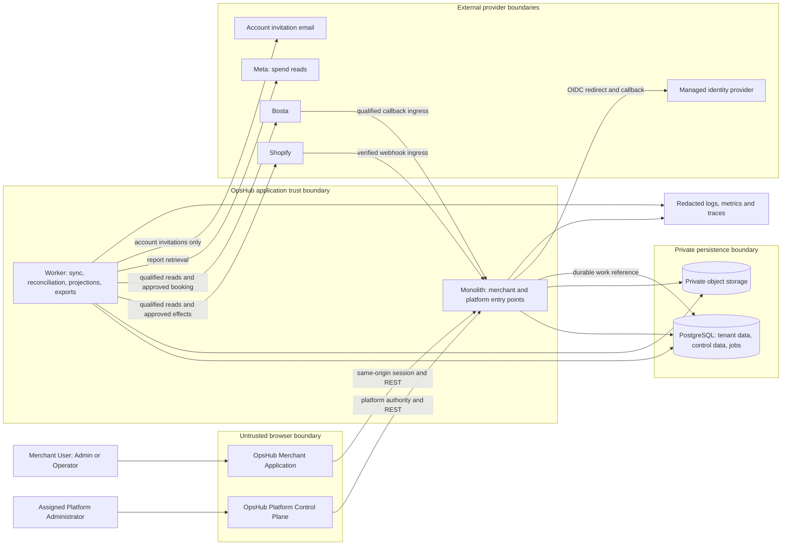

# OpsHub — system context and trust boundaries

**Proposed architecture**, governed by [OD01–OD09](../product/00-owner-decisions.md) and [permissions](../product/02-personas-and-permissions.md). Gentry is an evidence/regression source, not a runtime dependency. The diagrams describe the target system, not observed Gentry topology.

## Boundary contracts

| Boundary | Trust decision and permitted information |
|---|---|
| Browser → application | Browser supplies requested context and intent, never trusted actor/tenant/role/result. Server validates session, active participation, requested scope, input and action eligibility |
| Merchant → platform surface | Separate route namespace, authorization guard, DTOs and database pool. Common account identity does not merge grants. Platform reads administrative/aggregate records, never operational customer payloads |
| API/worker → persistence | Runtime roles do not own tables or bypass RLS. Each merchant transaction establishes one checked tenant context; exports/projections obey the same boundary |
| Provider → webhook ingress | Verify provider authenticity before accepting tenant ownership. Resolve signed/verified provider account to an existing connection; never trust payload merchant ID. Persist inbox before acknowledging |
| Worker → provider | Server credentials only; exact connection/account checked. All writes enter the action coordinator. Meta has read-only capability. No provider token reaches the browser/control-plane response |
| Object store | Private buckets, environment/merchant/object prefixes plus authorized DB metadata. Keys are not permissions. Downloads reauthorize; customer-bearing exports stream through the authenticated API |
| Identity provider | Authentication establishes issuer/subject, not merchant/platform authority. Local grants and sessions govern business access |
| Observability | Allowlisted metadata/aggregates; no contact details, narrative, tokens, payload bodies, signed links or financial mutation variables |

The platform and merchant UI may be distinct bundles served by one origin. Separate UI deployments and distinct product authentication systems are unnecessary. Platform pool restrictions are a defense against accidental application queries, not containment of a fully compromised web process holding both pools. [10](10-security-threat-model.md) records this residual risk.

## Main interactions

Inbound Shopify/Bosta data becomes observations and selected working state, then refreshes attention and analytics. Meta reports become period spend revisions. Merchant users contact customers outside OpsHub and record evidence. Operators prepare requests; Admins authorize immutable intentions. Worker execution and later read/result evidence update individual effects. Case closure evaluates required effects and physical/business evidence separately.

No automatic customer communication or billing/payment processor is proposed. Invitation mail supports account onboarding, not merchant-customer outreach. Commercial state is a manual platform-admin record, independent of order payment. [02 modules](02-architecture-style-and-modules.md), [06 effects](06-external-action-safety.md) and [11 privacy](11-audit-provenance-and-privacy.md) define the detailed boundaries.
