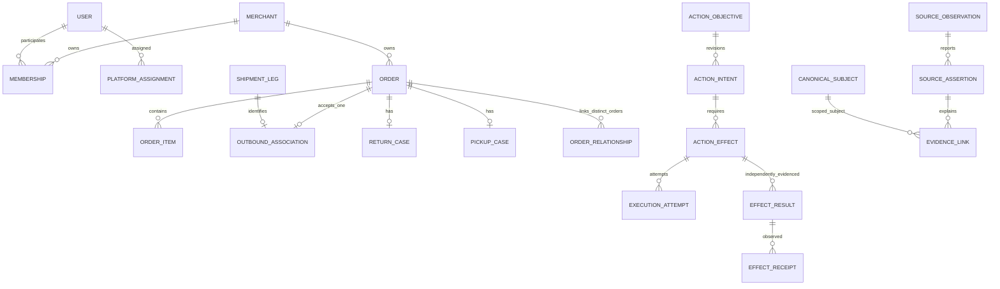

# OpsHub — persistence and invariants

**Proposed logical database design**, not executable SQL or production migrations. PostgreSQL holds current working data plus append-only evidence/history, without full event sourcing. [ADR003](adr/ADR-003-persistence.md) and [ADR010](adr/ADR-010-audit-and-provenance.md). The [canonical catalog E01–E26](../domain/01-entity-catalog.md), OD01–OD09 overlay and [product trust contracts](../product/10-audit-data-quality-and-trust.md) govern grain and certainty.

## Common record contracts

Use canonical UUID IDs; do not encode provider/order number/time semantics into them. All tenant entities have `merchant_id`, `id`, creation/recording time and current `version` where mutable. Parent references use `(merchant_id,id)` against a unique parent pair. Occurrence/effective/source-updated/observed/ingested/calculated clocks remain distinct with precision/timezone metadata; unknown occurrence time is nullable. Use UTC instants when known, preserve original local/date-only values when not. Quantities and money use explicit decimal precision/currency/basis; API transports money as decimal strings, not binary floats. Unknown/null, evidenced zero and negative adjustments remain distinct.

Tables below are logical records that may share a closely related physical subtype/history table after implementation review. A table name is not a new product capability. Material columns/constraints are identified here; full DDL is deferred.

| Record group / major tables | Keys, relationships and owned meaning |
|---|---|
| `merchants` | Tenant root; timezone/default-currency **configuration**, readiness/service state/version; default never fills missing transaction currency |
| `users`, `external_user_identities`, `sessions` | Platform-scoped shared identity; unique `(issuer,subject)`; hashed token/session expiry/revocation; identity grants no business access |
| `merchant_memberships`, `invitations` | Tenant + User; unique tenant/User current membership, role/status/auth revision, retained history; invitation hashed token, recipient, expiry, used/revoked state |
| `platform_operator_assignments`, `platform_assignment_scopes`, `admin_recovery_records` | User + explicit capability/target scope; no tenant-owner membership implied; reviewed grant/recovery history and legitimate authorizer |
| `plan_assignments`, `service_state_history` | Merchant-admin metadata, manual commercial/effective status, billing membership, platform actor/reason; no invoice/processor/customer-payment ledger |
| `source_contexts`, `provider_accounts`, `connections`, `credential_versions` | Tenant/source namespace/provider account binding; unique active provider-account owner per environment; capability/schema/API version, state, encrypted secret reference/rotation/revocation; manual artifact lineage is not an account |
| `canonical_subjects`, `external_identity_bindings` | Subject anchor `(merchant_id,id,kind)` owned/created by its domain module; typed entity has matching anchor. Evidence links FK to anchor, not an unchecked polymorphic ID. Verified binding unique `(merchant_id,namespace,kind,native_id)`; descriptive aliases/candidate bindings are nonunique |
| `customers`, `order_contact_snapshots` | Optional merchant-local evidenced customer; Order snapshot preserves purchaser/recipient/contact/address independently; no phone/name uniqueness or cross-tenant merge |
| `orders`, `order_items`, `order_relationships` | Order and line identities; optional resolved Customer/Product/Variant; separate business/payment/fulfillment/confirmation interpretation fields with provenance links; typed original→new order link with action/evidence and same-tenant FK |
| `confirmation_participations`, `confirmation_evidence` | Unique tenant/Order participation; first entry/date/basis retained across reopen; many evidence assertions, optional real Contact event; tag observed today does not supply consent time |
| `operational_cases`, `return_cases`, `pickup_cases`, `case_requirements` | Specific work identity/owner/version/closure evidence; one canonical case per `(merchant,Order,case_kind)` for confirmation/return/pickup; return/pickup subtype refers to that root case, never another contact case. Independent disposition/contact/physical/payment views; required work drives closure |
| `contact_objectives`, `contact_attempt_reservations`, `contact_events`, `contact_intake_observations` | One customer-contact objective per canonical contact case, unique tenant/Order/case-kind and tenant/case. Physical purpose/classification changes do not mint a new case/budget. Pre-call reservation owns ordinal 1–3/actor/exclusive eligibility; actual events separately record occurred/reach evidence, including reported excess or unauthorized calls as violations. Imported counters remain summaries, not events |
| `physical_collection_evidence`, `case_state_history` | Named customer handover/courier collection purpose, actor/source/occurred/recorded basis; corrected/withdrawn evidence appends; case completion is independent of payment |
| `shipment_legs`, `outbound_order_shipments`, `shipment_case_links`, `delivery_attempts` | Each accepted courier object has canonical identity/purpose; unique tenant/Order outbound association; reverse links require evidence. Individual attempts only with event identity/time; reported count is a separate observation |
| `replacement_requests`, `action_objectives`, `action_intents`, `action_approvals` | Original Order and contact/recovery objective, immutable intent revision/hash, exact recipient/items/commercial/side-effect flags, Admin membership/version and dependency snapshot. Objective owns one current intent until safely released |
| `action_effects`, `effect_reservations`, `execution_attempts`, `effect_results`, `effect_receipts`, `action_history`, `fallback_handovers` | Effect identity independent of execution attempts/result receipts; unique current reservation per objective/effect scope, provider request/result refs, known-no-effect/unknown/reconciled evidence; multiple independently evidenced duplicate results allowed |
| `products`, `variants`, `product_aliases`, `product_context_observations` | Verified native bindings; variant SKU labels nonunique/mutable; dated stock/cost/margin/season/classification with source/grain/as-of; no stock-movement or season-management engine |
| `advertisements`, `spend_series`, `spend_revisions`, `attribution_mappings` | Ad/account/campaign references as sourced, identity only when verified; series includes account/grain/window/timezone/currency/tax/reporting parameters; revised values append within series |
| `revenue_adjustment_observations`, `spend_allocation_runs`, `spend_allocation_portions` | Evidenced item-sales adjustments and linked reversal identity; no native refund executor. Allocation method/input versions/portion plus unallocated remainder; parent amount not added again |
| `source_observations`, `source_assertions`, `evidence_links`, `working_interpretations`, `corrections`, `conflicts` | Observation payload/locator/digest and source metadata; independently conflicting field assertions; interpretation selects evidence/method/version. Anchor links are checked tenant relations; unresolved subjects remain source-scoped, not invented domain instances |
| `inbox_receipts`, `sync_runs`, `sync_checkpoints`, `import_runs`, `import_row_dispositions`, `export_runs`, `file_objects` | Verified receipt uniqueness/account, paged sync coverage; immutable file hash/mapping/source/scope replay identity; every row/group disposition; requester/filter/permission/input revision and private object metadata |
| `policy_revisions`, `tenant_revision`, `projection_runs`, `metric_results`, `metric_contributors`, `attention_entries`, `tenant_health_summaries` | Applied definitions/effective policy; monotonic input revision/generation IDs and derived contributor/attention/health results. Revenue contributors retain attribution eligibility/amount/unattributed balance separately from spend portions. Queue insertion shares the domain transaction; no second general work scheduler |
| `audit_entries`, `administrative_audit_entries` | Append-only actor/context/authority/prior/new/intent/effect/evidence links; tenant history separate from platform-safe administration records |
| Queue schema owned by pg-boss | Job transport/state/leases without customer payloads; service role separate from tenant-data role; jobs are not business effect truth |

## Canonical entity coverage and scope

E01–E04 map to Merchant/User/Membership/Source Context; E05–E07 to optional Customer/Order/Item; E08–E11 to Leg/individually evidenced Attempt/Contact/Confirmation; E12–E15 to Return/Pickup/Replacement request/External action; E16–E19 to Product/Variant/dated product-period projection or source snapshot/Inventory observation; E20 to sourced season context; E21–E23 to Ad/Spend/revisioned allocation; E24 wallet/fee observations remain evidence/context, not a settlement ledger; E25 maps only to embedded case commitments/ownership, not arbitrary tasks; E26 maps to platform assignment. Reports/snapshots are versioned projections or observations, not factual events. Historical wallet rows preserve payment/net/cash-out/component-versus-total meaning without manufacturing transactions.

## Important invariants

| Constraint / mechanism | Effect |
|---|---|
| Nonnull tenant keys + composite FKs + RLS/write checks | Child/evidence/result/contributor cannot point across merchants |
| Unique accepted outbound `(merchant_id,order_id)` | OD06; raw second consignment is held/discrepancy evidence, never silently dropped |
| Unique return/pickup subtype `(merchant_id,order_id)` | OD06; repeated/partial unsupported history stays unresolved source observation |
| One current action objective + effect reservation | Cross-Admin dedup persists through unknown result, manual handover and terminal success; only reliable no-effect/safe prestart supersession releases it |
| Unique canonical contact case/objective and authorized reservation ordinal ≤3 | All ordinary attempts consume allowance; success/reopen never reset it. Outstanding/uncertain reservation holds capacity and exclusive calling eligibility. Actual excess-call evidence is retained and blocks new starts rather than being rejected by the ordinal constraint |
| Unique verified namespace/native ID, not aliases | Idempotent ingestion of stable provider objects; ambiguous references do not auto-link |
| Unique client operation key + payload hash | Exact replay returns original operation; changed payload with same key fails; intent/objective checks catch two different client keys |
| Immutable approved intent/evidence/history via grants | Edits create revisions; changing material state invalidates unstarted approval |
| Allocation/reversal conservation checked transactionally | One reversal not counted as both return and refund; one source spend equals chosen portions plus remainder at declared grain/currency |

Detect replacement self-links/cycles and duplicate links in the module transaction. Known provider duplicate effects are retained in `effect_results` and observations even when a second accepted association is forbidden. Discovery cannot erase the unintended consequence or certify it was authorized.

## Relationship sketch

## Transactions and storage layout

An ingestion page commits observations, dispositions, interpreted domain changes, tenant revision and queue work together before advancing checkpoint. Action approval commits immutable intent, checked reservation, approval/audit and queue insertion atomically. **Before an external call**, lock the objective and reserve one eligible attempt for one active actor; issuance requires the minimal independent contact-start recovery record in 13. Later evidence recording consumes that reservation and updates actual time/reach/next eligibility without pretending reservation time was call time. Case closure verifies required effects/evidence against current versions in one transaction. Provider/object-store I/O never occurs while holding a database transaction; ambiguous issuance keeps the reservation held.

Prefer explicit relational columns for relationships, business-state dimensions, indexes and monetary contributors; JSONB holds bounded source payloads, original typed assertion values and versioned intent snapshots. No EAV replacement for domain tables, giant order blob, unchecked polymorphic FK or global status field. Index tenant plus stable sort/date/native-ref/objective fields; partition evidence only after measured table-growth need. [11](11-audit-provenance-and-privacy.md) defines belief explanation and retention.

Use a finite typed MVP concept catalog: separate business/payment/fulfillment/confirmation, courier purpose/state/finality, pickup purpose/physical/payment, contact reach/budget, product context, revenue and spend basis. The owning module updates selected interpretation and its typed current fields within **one unit of work**; an interpretation is the evidence/selection record for that value, not another independently editable truth engine. Combine related subtype/history storage where safe; do not create one repository/framework per logical name. Canonical cases reopen under the same identity. Administrative-only work has no customer-contact objective/KPI membership; ambiguous imported case association remains held, not another denominator.
