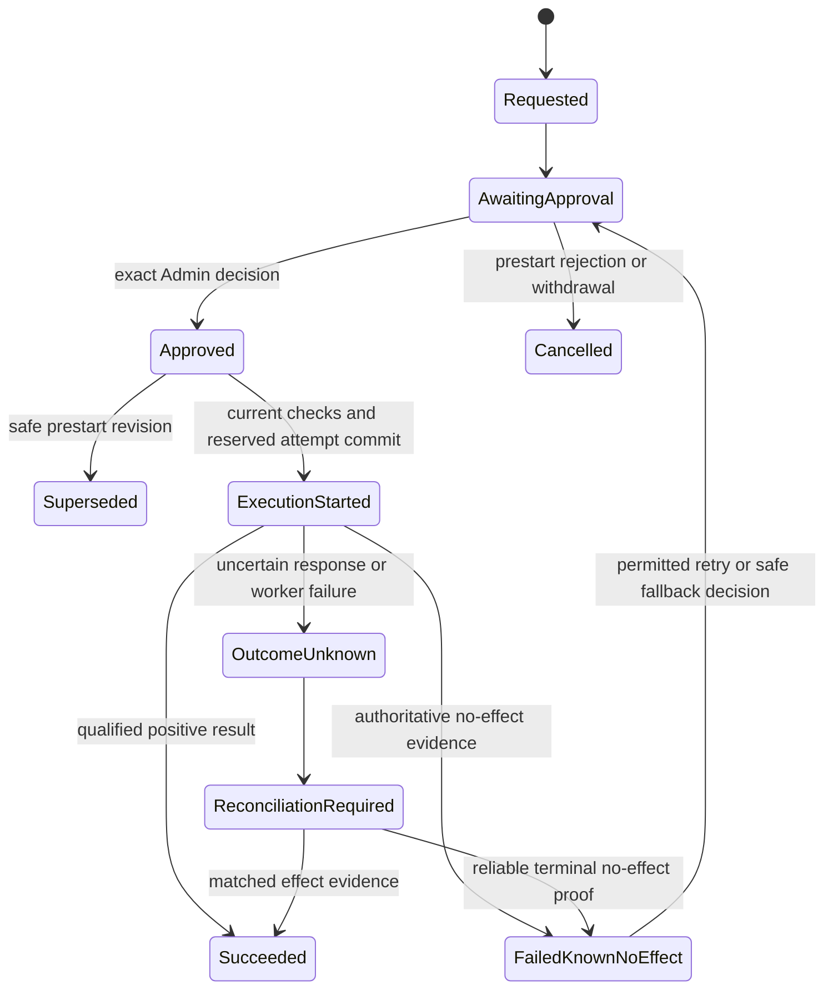
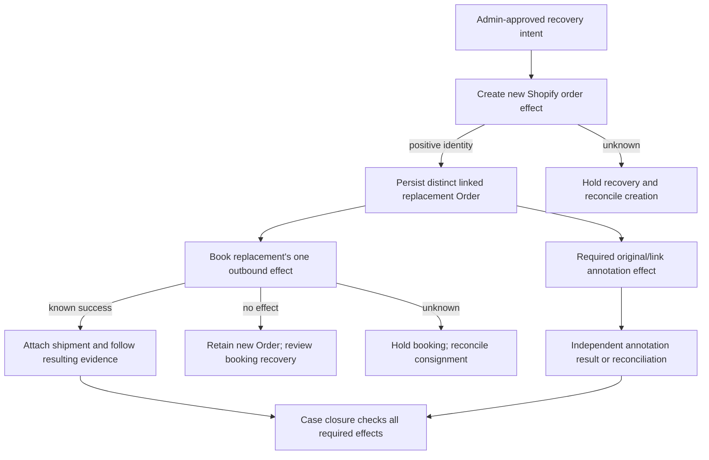

# OpsHub — external action and effect safety

**Proposed safety protocol**, implementing OD03/OD06/OD07/OD08 and ACT01–ACT03/FB01–FB03. [ADR006](adr/ADR-006-external-actions.md). A database transaction cannot make an HTTP provider mutation atomic with local persistence. OpsHub guarantees controlled local authorization/deduplication, not exactly-once effects at an unqualified provider.

## Identity and authorization

An `action_objective` is the stable business objective: booking the order's sole outbound, cancelling one order, or replacing an original order for one reviewed recovery objective. It survives requests, revisions, retries, handover and unknown results. Two different browser keys do not create two actionable objectives. `action_intent` is an immutable revision: merchant, source account, subject/recipient/items, amount/currency/payment basis, reason, prerequisites, required effects, customer-notification/refund/restock flags and reviewed state versions. Hash canonical serialized intent. Material edits create a revision and invalidate unstarted approval.

An approval identifies active Merchant Admin Membership/User, current auth revision, time, exact intent/hash, applied policy and dependencies. Admin may approve their own request; mandatory dual approval is not MVP. Operators prepare; platform cannot approve, execute, accept consequential fallback result or lift a block. Before **each unstarted effect**, worker rechecks current Admin authority, merchant service state, connection capability/ownership, subject versions and earlier results. Changes lead to review/reapproval, never quiet execution of stale intent. Record automation origin separately from human authority.

## Action versus effect state

Action is an aggregate of its required effects; it is not completed just because one effect succeeded. Each effect uses the following state contract:

`ExecutionStarted` is committed **before** network transmission. It conservatively means request may have been sent. A crash before send may therefore become unknown; safety takes priority over automatic progress. Record provider accepted/in-progress/job ID as result evidence while physical completion is still separate. Prestart cancel/supersession cannot erase an in-flight request. Receipt duplication does not create another result; independently evidenced provider duplicates do.

## Execution protocol and concurrent Admins

1. Within one transaction, validate actor/tenant/current state; lock the stable objective, then relevant merchant authorization/service/dependency rows in a documented order. Acquire/retain the unique current-intent and effect-scope reservation. A competitor receives existing-intent/conflict information scoped to its tenant. Commit approval/audit plus durable work together.
2. Worker claims work, checks the existing effect state/reservation and revalidates current authority/dependencies. A compare-and-swap on version/token transitions **one** effect to ExecutionStarted and inserts the attempt/intent/request correlation metadata. Commit. No provider request occurs in the transaction.
3. Confirm the immutable pre-dispatch recovery marker in private object storage under 13's protocol. Storage failure/uncertainty blocks sending. Then send the exact serialized request once, with documented provider idempotency/correlation identity only where supported. Disable automatic HTTP/SDK write retry. Record send start/return metadata without tokens or payload logs.
4. Append independently evidenced result and receipt; update state, canonical association, audit and follow-up work transactionally. A reliable create identity is positively matched, not guessed by phone/name. Conflicting/cross-account results are held.
5. A lost response or local commit/worker failure leaves the effect unknown and reservation held. Job redelivery reads state and schedules a safe read/reconciliation; it does **not** send the mutation again.

Use a fencing/version token for local worker writes; a stale worker cannot overwrite newer local state. A local fence cannot stop a request already transmitted or a paused old process from later sending. Before releasing a known-no-effect reservation or handing over, prove the old execution path cannot still dispatch (worker terminated/drained and request lifetime settled) **and** that the provider contract/evidence establishes no effect. Lease expiry alone does neither. A timed-out worker is quarantined for mutations; no replacement worker resends its effect. Proposed reconciliation/HTTP limits are operational controls, not proof of provider nonexecution.

Browser idempotency keys have tenant+operation+payload hash uniqueness. Exact repeats return original result/status; changed payload with the same key is a conflict. Business objective reservations are the second layer, including cancellation-versus-booking/replacement conflicts where reviewed policy says they are incompatible. After success, reservation remains tied to the realized order/shipment/objective; UI resubmission cannot produce another effect. A genuinely new future recovery objective needs explicit scope approval; it is not an MVP retry shortcut.

## Retry classification

| Result knowledge | Permitted behavior |
|---|---|
| Local validation/authorization failure before dispatch | No effect; correct/review intent. Preserve denied attempt audit |
| Documented provider terminal rejection establishing no effect | Controlled retry of unchanged intent or revised reapproval; store error/negative evidence and ensure old execution cannot still send |
| Qualified provider idempotency with known retention/parameter semantics | Reconciliation remains first; any replay of unknown result requires that exact contract/key still protects the original operation. MVP default remains block until result is resolved |
| Timeout/connection reset/5xx/missing response/local commit failure | OutcomeUnknown; reserve objective, safe reads/human investigation; no connected or manual mutation retry |
| No record found in stale/incomplete search | Still unknown; absence is not a negative execution contract |
| Success acknowledgement with async job | Poll qualified job/result; do not resend; business physical outcome remains separate |
| Positive duplicate result | Retain both effects, flag invariant violation, require Admin/provider resolution; no automatic deletion/cancel/refund compensation |

Shopify documents `orderCreate` as an offline-token/write-orders mutation and cancellation as irreversible with async result and possible payment/inventory effects. Its idempotency directive is capability-specific; this design does not assume it protects creation/cancellation. [Order creation](https://shopify.dev/docs/api/admin-graphql/latest/mutations/orderCreate), [cancellation](https://shopify.dev/docs/api/admin-graphql/latest/mutations/orderCancel), [idempotency support](https://shopify.dev/docs/apps/build/apis/graphql-admin/implementing-idempotency). Bosta business reference is a linkage/correlation field, not currently a verified uniqueness guarantee;18 records the limitation in evidence.

## Replacement partial success

Never recreate the replacement because booking failed. No distributed rollback, auto-refund or compensating cancellation is proposed. An Admin reviews any later corrective effect separately. A combined approval may authorize its exact creation+booking+annotation plan, but every effect checks current authority, returned identity and unchanged recipient/commercial scope; an unexpected create result demands review. Shopify customer-email options are off by default. Cancellation eligibility must explicitly disclose unavoidable payment effects such as authorization release and inventory semantics; orders needing unapproved refund/side-effect treatment are unavailable for connected cancellation until OP06 qualification. No refund engine is added.

## Safe fallback and return to connected truth

Admin handover is allowed only for known not-started or reliably known-no-effect state, with blocked/terminated prior execution path. Within a locked transaction record current effect, reason, unavailable capability, negative-evidence basis, responsible Admin, irreversible handover token and make the integrated path nonactionable. Pending queue messages cannot dispatch after handover. Unknown earlier effect blocks handover.

Before authorizing the human to act, confirm the independently retained handover descriptor in 13 with the same business scope/known-no-effect basis and make issuance state authoritative. A lost local handover after DB restore must still block a new connected/manual effect. Storage/issuance uncertainty remains a held handover, not permission to execute. Object-store I/O is outside the database lock; a pending exclusive handover reservation protects the two-step issue process.

Record off-platform executor, exact intent, provider-native reference, occurrence/recorded times and positive evidence. Operator may submit evidence, Admin accepts consequential result. A statement without reliable identity/result remains unresolved. On recovery, provider evidence attaches to the same result/binding, not another order/shipment; conflicting references stay visible. Connection health and action completion recover independently. Retain request/approval/execution/result/reconciliation/handover audit for every step. Independent external actors are outside OpsHub's locking guarantees; qualified exclusive normal booking authority and discrepancy monitoring are required before pilot.
