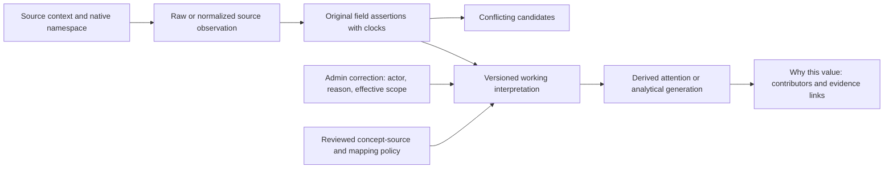

# OpsHub — provenance, audit and privacy

**Proposed design**, governed by ING01–ING10/AUD01–AUD06/TR01–TR07 and [canonical assertion semantics](../domain/03-events-and-projections.md). [ADR010](adr/ADR-010-audit-and-provenance.md). Current state is editable through controlled commands; available source history and audit are appended, not silently rewritten. This is selective revision history, not a full event-sourcing/CQRS framework.

## How a belief is explained

Each observation retains source identity/kind/API or file version, native ID or safe artifact/sheet/row locator, original data/hash, reported occurrence/effective/update time if known, observation/ingestion time, timestamp precision/timezone, request/run ID, source coverage/completeness and recording actor/automation origin. Preserve original identifier strings. A file revision is evidence lineage, not another provider namespace.

Normalize useful assertions into typed field values with original vocabulary, mapping version and evidence confidence. Source assertion, independently evidenced occurrence, manual attestation and derived estimate remain distinct. Invalid or unmatched input remains source-scoped with candidate links/reason; no fictitious Customer/Variant/Return is created merely to obtain a FK. Source summaries retain counters without synthesized events. Repeated same-provider revisions can be no-ops; independently real identical contacts remain distinct under their qualified import contract.

`working_interpretations` is revisioned per tenant/subject/concept, with selected assertion/correction IDs, mapping/source-authority policy, effective scope, decision actor/reason and conflict status. Material normalized changes also retain their domain state/version and tenant revision. The current pointer advances transactionally; the old interpretation persists within approved retention. Late input does not automatically override it. Corrections expire/supersede only by reviewed policy; they do not make a physical/financial occurrence independently verified. OP10 supplies the concept matrix; unresolved authority gives disputed/unknown rather than invented precedence.

“Why does OpsHub believe this value?” returns selected source/actor/time/basis, original and normalized value, policy/correction, other competing assertions, freshness/coverage and affected projections/effects. Visibility obeys merchant role; platform receives only redacted categories/aggregate health. Raw payload access is not a general support capability.

## Consequential audit

Append audit in the same transaction as important local state change. Fields: event ID, tenant or explicit platform scope, correlation/work ID, actual User, Membership/Platform Assignment and auth revision/capability, recording/automation origin, occurred/recorded time, command/reason, subject/version, prior and new **safe** state, immutable intent/hash/approval, execution attempt, provider request/result/evidence references, failure/unknown/reconciliation/handover. Sensitive prior/new values stay in protected evidence/intent records; general audit identifies changed fields and references, never token/address dumps. Imported claimed actors remain separate from authenticated importer.

Audit onboarding, membership/invitation/grant/recovery, service/commercial change, policy/mapping/connection change, import dispositions, corrections/physical attestations, contact attempts/budget/exhaustion, case closure/reopen, approvals/execution/results/reconciliation and exports. Denied scope/effect attempts log safe category/actor/request context without another merchant's record details. Report/export review records exact revision/as-of; later edits cannot inherit approval.

Runtime grants allow audit/observation append and authorized current-state update, not arbitrary history mutation/deletion. A separately controlled retention role can delete/redact under approved policy and append deletion manifest/tombstone; immutable means immutable through ordinary application editing, not legally undeletable PII. Infrastructure/database owner access remains privileged and audited. Backup/access controls and object digests aid tamper detection without claiming cryptographic proof against a fully privileged administrator.

## Customer data and access

OpsHub processes order recipient/purchaser names, phone/email/address, optional source Customer ID, contact narratives/reasons, commercial amounts/payment assertions and courier tracking/physical evidence. Merchant workforce identities and billing contact are separate administrative personal data. No cross-merchant customer profile, telephony recording, payment card data or unnecessary sensitive personal attribute is proposed.

Merchant Admin/Operator can view contact details needed for their own work; queries return minimum relevant fields. Operator exports exclude contacts and free-text narratives. Contact-bearing export is explicit Admin scope with step-up/current authorization/audit. Platform staff see merchant/member/billing administration and redacted health; no customer-contact browsing, operational payload export or impersonation. Logs/traces never store narratives, contacts, tokens or signed URLs. Use keyed scoped pseudonyms if correlation is necessary; unsalted phone hashes are not anonymization.

## Practical retention boundaries — proposals requiring OP12 approval

No unlimited raw-payload policy is proposed. These are concrete review values, **not authorized deletion settings**; no retention job may perform destructive deletion before owner/legal approval and hold policy. Data minimization applies at initial capture regardless of duration.

| Class | Proposed boundary / preservation rule |
|---|---|
| Webhook/API raw payload and fallback input file |30 days encrypted/private, restricted operator access; keep minimal typed assertions/locators/digest after expiry; strip unneeded fields before storage where safe |
| Rejected/held payload excerpts |14 days of minimum actionable fields; unresolved critical evidence subject to explicit hold/owner review, not casual infinite raw storage |
| Export file/snapshot |24 hours file availability; customer-bearing download through session; retain metadata/scope/audit. Active generation pins needed interpretation versions until expiry |
| Operational debug logs |14 days redacted; no raw customer content; aggregate metrics longer if safe |
| Normalized evidence/interpretation and exported metric revisions |12 months proposed rolling history, with selected comparison/export metadata and evidence referenced by current selections/corrections/effects held as required; present loss of older reconstruction explicitly |
| Consequential audit/action/result and independent dispatch/handover/contact/privacy recovery records |24 months proposed, never shorter than every permitted backup restore horizon plus reconciliation margin/holds; coverage records and minimal unresolved reservation knowledge cannot be erased by job cleanup; minimize protected identifiers/content |
| Current order/customer/case records | While service operates; proposed closure review/grace90 days then approved deletion/redaction workflow. Administrative closure itself never deletes |
| Independent encrypted backup exports | Proposed30 days; provider PITR follows purchased plan. Document when deletion propagates through expiring backups; restored data reapplies deletion manifests before reopening |

Raw payload expiry cannot silently destroy unique evidence needed to explain an open action/conflict: first extract necessary minimal assertions, pin limited evidence with reason/review date, then expire the rest. Unknown-effect evidence/reservations are never cleaned up as failed/old jobs. Holds must be reviewed rather than becoming an unexplained indefinite PII exception.

Merchant closure revokes provider credentials/session access under approved continuity policy, preserves unresolved effects and exports within the approved grace, applies deletion manifests/object lifecycle and backup expiry, and keeps minimum justified attribution/tombstones. Restore procedures must reapply approved deletions and prevent expired backups from resurrecting customer data. Owner/legal approve jurisdictions/residency, lawful basis/notices, exact retention, customer-rights handling and support disclosure. No compliance certification or invented statutory duration is claimed.

## Provider data requests and redaction

Privacy authorization/disposition manifests are independently retained in protected object storage with verified coverage as specified in 13; a DB rollback cannot erase the only record that customer data was redacted after the backup. Pending/completed/cancelled stages are explicit, minimum source-scoped identifiers remain protected, and restore access stays closed until approved replay and current authority verification complete. No broad immutable customer-payload archive is introduced.

Shopify App Store distribution requires the documented customer data-request/customer redaction/shop redaction topics. Verify raw-body authenticity and account-to-tenant binding before persisting an idempotent privacy request; wrong signatures cannot enqueue deletion or disclosure. [Shopify provider requirements](https://shopify.dev/docs/apps/build/compliance/privacy-law-compliance). Qualification selects the actual distribution and current deadlines/process requirements; a draft retention duration cannot override them.

Privacy jobs locate data through verified source Customer/Order identity and approved ambiguous-reference handling, never cross-tenant phone/name matching. An approved owner/legal policy governs verification, response disclosure, redaction/deletion scope, justified minimized protected audit/effect tombstones, holds and backups. Removing customer payloads cannot remove the reservation/result knowledge needed to prevent a duplicate effect. Data requests do not grant platform staff ordinary customer browsing. Keep an attributable request/disposition manifest and reapply completed redactions after restore; no deletion workflow is implemented or executed in Phase 4.
