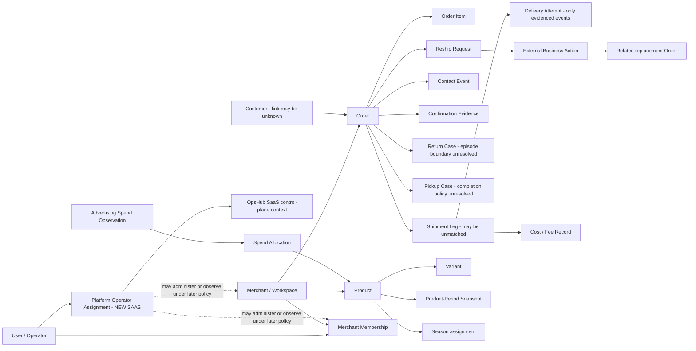

# Phase 2 — Canonical domain model

Prepared 13 October 2026; council review and bounded corrections completed 14 October 2026. **Draft for business-owner review; Phase 2 is not approved.** The owner's attached instruction closes Phase 1 and authorizes this package only. The reconstruction, its linked evidence, and `source/` remain unchanged. No application implementation or production inspection was performed in Phase 2.

**Bounded owner-requested correction, 14 October 2026:** the existing model is accepted subject to explicitly distinguishing merchant participation from platform operator authority. E26 Platform Operator Assignment adds that NEW SAAS boundary; the earlier council review predates this addition. Other domain decisions remain unchanged. Phase 2 approval is still pending this correction's review.

## Purpose and reading order

Describe the business independently of spreadsheets, screens, storage, APIs, and technology. This is a proposed canonical vocabulary and model for a future merchant SaaS, grounded in the approved reconstruction. It is not a product requirements document or target architecture.

| Document | Review purpose |
|---|---|
| [01 Entity catalog](01-entity-catalog.md) | Purpose, grain, identity, ownership, attributes, relationships, lifecycle, invariants, source mapping, questions |
| [02 Identities and relationships](02-identities-and-relationships.md) | Identifier scope, cardinalities, customer/actor uncertainty, merchant boundary |
| [03 Events and projections](03-events-and-projections.md) | Facts, assertions, actions, derived results, clocks and monetary provenance |
| [04 State machines](04-state-machines.md) | Evidenced workflow fragments, separate state dimensions, missing transitions |
| [05 Invariants](05-domain-invariants.md) | Verified scoped rules, proposed canonical constraints, owner decisions |
| [06 Glossary](06-canonical-glossary.md) | Current terminology mapped to precise canonical meanings |
| [07 Decision register](07-policy-decision-register.md) | Business-policy decisions, evidence needed and safe modeling positions |
| [08 Mapping](08-reconstruction-to-canonical-mapping.md) | Live → historical → external identity traceability |
| [09 Open questions](09-open-domain-questions.md) | Identity blockers, evidence gaps, confidence and review agenda |

## Evidence and semantic labels

Two independent labels apply: evidence certainty and model treatment. **A proposed canonical entity is not proof of an existing table, enforcement rule, or event history.**

| Evidence label | Meaning |
|---|---|
| VERIFIED FACT | Direct Phase 1 observation, scoped to the named artifact, output, UI contract or arithmetic |
| STRONGLY SUPPORTED INFERENCE | Interpretation supported by observations but not directly established |
| UNRESOLVED | Missing or contradictory evidence; no selected answer |

| Semantic label | Meaning |
|---|---|
| PRESERVED | Preserve an established business distinction or source meaning |
| NORMALIZED | Propose a clearer canonical representation without claiming Gentry already uses it |
| NEW SAAS | Introduce a merchant or platform-domain concept needed by the explicitly requested SaaS model |
| POLICY UNRESOLVED | `TBD — OWNER DECISION`; retain alternatives and provenance |

Evidence references use reconstruction document numbers, rule IDs BRxx, discrepancy IDs Dxx and live ledger IDs Lxx. These resolve to the unchanged [Phase 1 entry point](../reconstruction/00-system-map.md), [rules](../reconstruction/05-business-rules.md), [discrepancies](../reconstruction/13-live-vs-spec-discrepancies.md), [questions](../reconstruction/14-open-questions.md), [live ledger](../../evidence/live/observation-ledger.md), and [workbook findings](../../evidence/artifacts/workbooks/WORKBOOK_FINDINGS.md). Original workbook cell locators are retained in the mapping document. Phase 1B observations qualify earlier technical inferences; neither establishes backend enforcement.

## Canonical scope

The [catalog](01-entity-catalog.md) defines 26 entity kinds, including conditional proposals. An entity has independent business identity and history; not every kind can be instantiated from current evidence. Observation/revision identity, logical series identity and source artifact identity serve different purposes. Spend Allocation needs independent entity continuity only when retained for separate reconciliation/history; otherwise it remains a referenced projection.

- **Merchant, platform and identity:** Merchant/Workspace, User/Operator, Merchant Membership, Platform Operator Assignment, Source Context, Customer.
- **Commerce and operations:** Order, Order Item, Shipment Leg, Delivery Attempt, Contact Event, Confirmation Evidence, Return Case, Pickup Case, Reship Request, External Business Action.
- **Product and economics:** Product, Variant, Product-Period Snapshot, Inventory Observation, Season, Advertisement, Advertising Spend Observation, Spend Allocation, Cost/Fee Record.
- **Human work:** Operational Task.

Delivery Attempt is a first-class event **when individually evidenced**. Return Case and Pickup Case are normalized business identities with unresolved episode/partial-item boundaries. Advertisement and spend identities are conditional on source evidence. Operational Task represents independently tracked human work; a queue row or courier exception is not automatically a task. Refund execution/financial transaction, production batch, stock movement and separate Return Item identities are deferred, not silently inferred.

Value objects/relationships include money with provenance, order contact snapshot, source identity, actor attribution, product economics observation, item allocation, order relationship, season assignment history and evidence reference. Named source-observation bundles preserve Courier Wallet Observations and Contact Intake Summaries at their original grains without manufacturing transaction/contact events. Derived projections include order outcome, stage, retry eligibility, cleanup issues, repeat-phone indicators, product tiers/advice and KPI values. See [01 classification](01-entity-catalog.md#objects-that-are-not-additional-entities).

## Central normalization decisions

| Current representation | Business distinction | Canonical treatment / reason |
|---|---|---|
| Spreadsheet raw rows and masters | Order headers, order lines, shipment legs and wallet entries have different grains | Separate Order, Order Item, Shipment Leg and Cost/Fee Record; sheet boundaries are not entity boundaries. 569 legs have 534 nonblank references and 28 multi-leg references. [03](../reconstruction/03-domain-model.md), [07](../reconstruction/07-data-model-observations.md) |
| One courier summary on order | Transport activity can involve several legs and purposes | Preserve all evidenced leg identities and types; leave summary selection and physical routing unresolved (PD09). A return leg marked Delivered does not prove goods were kept (L16–L17). |
| Status/outcome/stage labels | Commercial, financial, fulfillment, handoff, transport and customer disposition dimensions differ | Store/report source assertions distinctly; derive outcome/stage using named policy. Preserve 29 blank exported outcomes and fallback labels (D04–D05). |
| Phone-based repeat logic | A phone observation is not a person identity | Customer is merchant-local; retain order contact snapshots and uncertain links. No automatic person merge by phone (PD12). |
| Caller names and confirmation tags | Recorded label, asserted attribution and authenticated actor differ | Explicit actor provenance; Confirmation Evidence can be tag evidence rather than an actual consent event. Unknown actors/timestamps remain unknown (D08, D10). |
| Paid → Collected in workbook | Payment and physical collection are separate | Pickup Case retains both evidence dimensions. Historical inferred pickups remain inferences; no automatic physical collection (D01–D03, PD03). |
| Call resolution/refund fields | Contact recording differs from executing service or money movement | Preserve Contact Event assertions; link separately evidenced External Business Actions. An approval/request/tag does not establish completed external effects (BR18, PD06/PD10). |
| Wallet cash-cycle row | Provider financial statement assertions differ from charges and bank settlement | Preserve COD, online payment, fee components/total, net value, payment status/time and cash-out reference as a named observation bundle. Fee components and total are not additive duplicates; a recorded Paid label is not independently verified settlement. |
| Weekly product rows and current dashboards | Dated snapshots, current inventory and selected-period computations use different clocks | Snapshots and inventory observations retain subject, period/as-of, definition, revision and source; advice remains a projection (D21–D22). |
| SKU text and product names | Product identity differs from variant identity and descriptive labels | Separate Product/Variant and preserve unresolved crosswalks; do not invent variant IDs from item summaries (PD13). |
| Single Gentry operation | Future merchant boundary and operator participation | Merchant/Workspace and Merchant Membership are NEW SAAS concepts; current tenancy/RBAC is not verified. |
| Merchant-side participation versus future platform administration | Account identity does not determine authority context | NEW SAAS E26 Platform Operator Assignment separates SaaS control-plane authority from E03 Merchant Membership. Neither implies the other; the same resolved User may have both without automatic cross-merchant access. |

## Platform administration and deferred product boundary

One canonical User/Operator concept supports two independent participation relationships: Merchant Membership within a specific Merchant/Workspace, and Platform Operator Assignment within the OpsHub SaaS control plane. A platform operator can administer or observe Merchant/Workspace records and merchant memberships under separately defined platform authority, without becoming a member of every merchant. Platform assignment is not permission to access every merchant or perform every action; exact scope and capabilities remain later PRD/architecture decisions. Merchant-owned operational records retain their ownership.

Platform roles/permissions, super-admin capabilities, support impersonation, delegated access and access-control implementation are deferred. Provisioning, invitation, suspension, merchant onboarding, deletion and support-access workflows are deferred to the PRD; no onboarding lifecycle is introduced here.

SaaS commercial/billing concepts are outside the reconstructed Gentry operational domain and will be evaluated during the PRD/product-boundary phase. No Subscription, Plan, Invoice or Payment entities are added. Their exclusion here is not a decision that the future SaaS will lack billing.

## Conceptual map

This diagram shows **proposed conceptual relationships**, not proved live cardinalities or storage. Exact relationship statuses are in [02](02-identities-and-relationships.md).

Merchant-owned business relationships retain their merchant scope. Platform administration/observation of merchants and memberships is a distinct authority context through E26, not a business link between tenants or a grant implied by User identity. Shared identity supplies no access; matching native accounts and implementing authentication remain separate decisions.

## Non-negotiable preservation

Preserve original source values, namespaces, observation times, uncertainty and contradictions. Do not fabricate delivery-attempt events from a count, consent events from tags, collected pickups from paid/no-courier orders, refund transactions from call labels, or costs from missing inputs. A record may be unmatched or partial. Canonical policies must identify their version and authority; no universal KPI or transition precedence is approved here.

The five greatest review risks are authoritative KPI definitions (PD01), June courier completeness (PD02), physical pickup semantics (PD03), source authority/manual overrides (PD08), and multi-leg outcome plus return-episode identity (PD09/PD18). Retry/resolution, thresholds, economics and external-action consequences remain explicit owner decisions as well.

## Review and stop boundary

Owner review should approve/correct entity boundaries first, then decide policies independently. Identity-sensitive import cases remain unresolved without blocking vocabulary for the rest of the domain. Confidence is high in the evidenced grain separations, moderate in proposed entity boundaries, and limited in identity crosswalks, cardinalities and policy-dependent lifecycle edges. Detailed assessments are in [09](09-open-domain-questions.md).

Quality-review findings and dispositions are recorded in [Phase 2 review evidence](../../evidence/domain/quality-review.md). Baseline integrity is checked against [the Phase 2 pre-write manifest](../../evidence/domain/phase2-baseline-manifest.json). **Stop after this model for human review.** No PRD, architecture, database, API, UI or implementation follows from this package.
