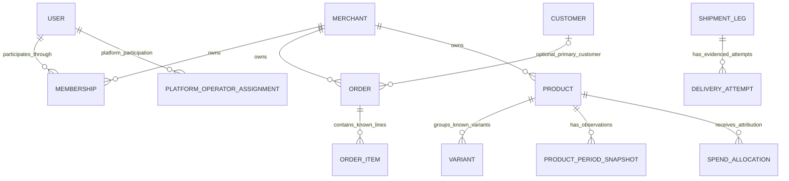

# Identities and relationships

Evidence: Phase 1 [domain](../reconstruction/03-domain-model.md), [data](../reconstruction/07-data-model-observations.md), [permissions](../reconstruction/09-roles-and-permissions.md), [migration risks](../reconstruction/15-saas-migration-risks.md). Entity EIDs refer to [01](01-entity-catalog.md); decisions PDxx to [07](07-policy-decision-register.md).

## Independent participation contexts — NEW SAAS

User/Operator (E02) is the common canonical account concept. Authority comes through a distinct participation relationship, not through identity alone:

| Participation concept | Authority context | What it does not imply |
|---|---|---|
| Merchant Membership (E03) | Exactly one Merchant/Workspace | Platform administration or authority in another merchant |
| Platform Operator Assignment (E26) | OpsHub SaaS control plane, with exact capabilities/scope deferred | Merchant Membership, unrestricted merchant access or universal super-admin capability |

One resolved User may have both relationships, with their authority kept separate. A platform operator does not need Merchant Membership in every tenant to administer or observe Merchant/Workspace records and merchant memberships under future platform policy. Cross-merchant access is never inferred merely because the same User exists; platform scope must be explicitly defined later. These are canonical NEW SAAS semantics, not evidence of current authorization or authentication architecture.

## Identity rules

**PROPOSED CANONICAL:** canonical identity represents continuity of a business object. Source identities are bindings, not replacements for it. Different sources describing the same object need evidence-backed matching, not equality of names or customer phones. Canonical identity carries merchant context for all merchant-owned objects.

| Identifier | Verified scope / interpretation | Canonical handling / unresolved boundary |
|---|---|---|
| Shopify order Name/reference | Header identity and Bosta business-reference bridge; exact trimmed reconciliation supported overlapping cohorts | Preserve original string and Source Context. Human-readable name stability/uniqueness across stores/time is not established; do not strip prefixes/coerce numerically. Native Shopify order ID not reconstructed. |
| Live order internal detail ID | Separate from Shopify name/reference | Preserve as current-system binding; not proof of external commerce identity or global uniqueness. |
| Bosta tracking | Text consignment identity; 569 distinct supplied keys | Bind to Leg in courier-account context; preserve leading zeros/text. `RAW_Costs Order Id` and intake tracking reference it. Numeric fallback in workbook is historical matching behavior, not canonical equivalence. |
| Bosta business reference | Links consignment to commerce order; four blank, 28 multi-leg references | Optional link candidate to Order, independent of tracking. Blank/ambiguous does not justify customer/phone join. |
| Wallet record | Current 1,381 tracking keys unique, but SUMIF permits several entries per tracking | Tracking identifies charged subject, not universally fee-entry identity. Use source record locator when native fee ID absent; do not dedup all fees by tracking. |
| Source-reported Business ID / Cash-out ID | RAW_Costs A/AJ retain one Business ID and 78 distinct cash-out values in supplied history | Business ID is a namespace binding candidate, not established Merchant/account equivalence. Cash-out ID preserves provider grouping, not proven bank payout identity. Namespace/reuse/payment semantics PD20/PD24. |
| Call/contact record | 239 events; exported schema lacks native event ID | Retain source file/revision and row locator, original timestamps/labels/link candidates. Import dedup identity is PD16; identical text/times can still be distinct real contacts. |
| Intake record | 75 tracking-keyed summaries; cumulative attempts | Keep summary observation and native row locator. It cannot reconstruct individual contact identities or dates. |
| Product GID/internal ID | Separate live identities | Bind to Product in Shopify/current source contexts. Historical labels need crosswalk evidence. |
| Variant/SKU label | 60 historical priced/costed keys, spelling-dependent join | Preserve aliases and original labels. Native variant ID, SKU reuse and historical product changes unresolved; do not generate variant identity from a product name alone. |
| Ad name/keyword | Displayed matching evidence | Descriptive match, not stable ad identity. Native provider ID/account scope unknown. |
| Person/operator name/phone | Contacts and caller labels, one session | Nonunique and mutable evidence. No automatic Customer/User creation or merge from literal equality. |
| Product week/season name | Period input/name labels | Period identity includes definition/calendar/source; season has independent identity. Revisions retain separate provenance. |

External identity namespace is conceptually **Merchant + native-object namespace qualified through Source Context + source object kind + original native reference**. This is a scope definition, not a storage key or guarantee that every descriptive reference is unique. An evidence artifact/lineage is a capture origin, not automatically the object's native namespace. Several exports/backups may observe one object; unknown native scope stays unknown while evidence-backed matching is preserved. PD20 must settle namespaces; PD08/PD12/PD13/PD16 settle ambiguous bindings. Uniqueness of one supplied population does not establish permanent provider constraints.

## Cardinality register

“Verified observed” describes the inspected dataset/UI only. “Proposed” is a canonical constraint for review. “Unresolved” has no chosen cardinality. `0..*` means zero or more; optional resolved links do not erase original unmatched references.

| Relation | Canonical / observed cardinality | Evidence status and qualification |
|---|---|---|
| Merchant → Membership → User | Merchant 0..* Memberships; Membership exactly 1 Merchant and 1 User | NEW SAAS/proposed merchant participation. Membership uniqueness/native account matching remain PD11/PD20; User identity does not confer cross-merchant or platform authority. No existing tenant/RBAC proof. |
| User → Platform Operator Assignments | User 0..* Assignments; Assignment exactly 1 User and platform context, no owning Merchant | NEW SAAS owner-required distinction. A User may have Assignments, Memberships, both or neither; no relationship creates the other. Exact assignment multiplicity/roles remain PRD decisions. |
| Platform authority context → Merchant/Workspace and Membership administration/observation | Potential merchant/membership targets, no mandatory merchant-membership link; exact target scope/multiplicity deferred | Conceptual control-plane boundary, not a grant of all-merchant access or a business relationship between tenants. Provisioning/onboarding/support workflows deferred to PRD. |
| Merchant → Customers / Orders / Products / Seasons / Source Contexts | Merchant 0..* of each; each exactly 1 Merchant | NEW SAAS/proposed ownership; Gentry single operation is verified. |
| Customer → Orders | Customer 0..* Orders; Order 0..1 resolved primary Customer | Proposed optional primary party. Multi-party payer/recipient semantics PD12; exact live customer relation unverified. No asserted mandatory customer. |
| Order → Order Items | Order 0..* known Items; each Item exactly 1 Order | Multiple raw lines per order verified. Zero represents unknown item decomposition/import evidence, not approval of empty commercial orders; minimum business quantity PD13. |
| Order → Shipment Legs | Order 0..* Legs; Leg 0..1 resolved primary Order in the **provisional** model | Multiple legs/order and unmatched legs verified (28 multi-leg references/four blank). One primary order/leg is an assumption for review, not a verified universal rule. Consolidated multi-order consignments PD09 can revise it; keep associations unresolved meanwhile. |
| Shipment Leg → Delivery Attempts | Leg 0..* individually evidenced Attempts; Attempt exactly 1 Leg | Proposed event grain; current evidence contains count only. Do not materialize count-many events. PD15. |
| Order → Contact Events | Order 0..* Events; Event 0..1 resolved primary Order | Multiple events/order verified (239/224); unresolved importer matching allowed. A contact spanning multiple orders would revise primary-link semantics (PD16). |
| Order → Confirmation Evidence | Order 0..* Evidence observations; observation 0..1 resolved Order until matched | Proposed observation history. Tags/manual values are current evidence; actual event identity/multiplicity unknown (PD19). |
| Order → Return Cases | Order 0..* distinct episodes **proposed**; Case 0..1 resolved original Order | Current labels/legs do not prove case count. Exact episode partition, partials, multi-order cases and minimum links PD18. Do not instantiate episode identity by guess. |
| Return Case → Legs / Contacts / Item allocations | Exact multiplicities unresolved | Supports known associations without assuming one case=one leg/call/item. Same leg's possible role in multiple cases PD18. |
| Order → Pickup Cases | Cardinality unresolved; each Case has one owning Order when resolved | UI is order-grain; one case/order versus partial/split episodes not established. PD03/PD18. |
| Order → Reship Requests | Original Order 0..* Requests proposed; Request 1 original Order when matched | Request UI and four historical replacement links verified. One-active-request rule absent; do not dedup by order alone. PD10/PD17. |
| Request → replacement Orders / actions | 0..* evidenced resulting Orders/actions provisionally | UI promises one new order plus booking, but successful request cardinality/retry/multi-output/failure unknown. Preserve result references without inventing success. PD10/PD17. |
| External Business Action → result → receipt observations | One intent can reference 0..* independently evidenced results; each result 0..* receipts, **proposed representational capacity** | Repeat observation is not a new result by itself; independently evidenced duplicates remain representable. Unknown result completeness/multiplicity is not zero. No actual Gentry retry outcome or receipt cardinality verified (PD10). |
| Order → related Orders | 0..* typed directed relationships | Four original→new histories verified; exact cycles/chains/exchange/replacement semantics PD17. Different orders remain distinct. |
| Product → Variants | Product 0..* known Variants; Variant exactly 1 owning Product in canonical model | Historical product/size grouping verified; current native variant crosswalk/reparenting unknown (PD13). Zero can mean unresolved decomposition. |
| Product → Product-Period Snapshots | Product 0..* Snapshots; Snapshot exactly 1 Product | Multiple weeks and product-period export verified. One current week entry is UI contract; revision/source identities proposed (PD08/PD21). |
| Product/Variant → Inventory Observations | Subject 0..* observations; each observation exactly 1 Product **or** Variant | Current product stock/dated stock observed; native stock grain unresolved. No assumed location multiplicity or variant breakdown (PD13/PD23). |
| Season → Product assignment | Season 0..* Products; Product 0..1 current Season **proposed/UI contract** | Move/untick contract supports single current assignment; execution/enforcement not verified. Historical assignments 0..*; overlap applicability PD14. |
| Product ↔ Advertisement | Matching association cardinality unresolved | Names/keywords/own count visible; collision/multi-product match PD14. No exclusive ad-product ownership assumed. |
| Spend Observation → Allocations → Product | Spend scope 0..* portions proposed; each portion 1 Product and defined interval, attributable source scope | Generic redistribution stated. Native decomposition, rounding/conservation, multi-source combination and unallocated balance PD14. |
| Shipment Leg → Cost/Fee Records | Leg 0..* Records; Record 0..1 matched primary subject provisionally | SUMIF permits several entries; current supplied keys unique; 812 unmatched wallet IDs preserved. Shared/aggregate fee allocation and fee IDs PD07. |
| Courier Wallet Observation → cash-out grouping / fee assertions | One source-row observation retains one recorded cash-out reference; grouping multiplicity/reuse semantics unresolved | Current 1,381 rows/78 distinct Cash-out IDs establishes repeated grouping references in this artifact, not payout event identities. Component/total fees are separately named views; no duplicate aggregation (PD24/PD07). |
| Task → subjects/actions | Cardinalities unresolved; exactly 1 Merchant | Independently authored tasks are conditional. Queue links do not establish a task table or mandatory ownership actor (PD25). |

## Proposed clear-grain relationships

This diagram deliberately excludes unresolved return/pickup/leg-link and source-account multiplicities. It represents canonical proposals, not live schema.

## Party and actor attribution

Order contact details are a historical snapshot even if later linked to a Customer. Recipient and purchaser equality is unresolved. Repeat-phone projection remains possible without a confirmed customer identity, provided its literal/normalized-phone rule is named and does not claim to count people.

Actor Attribution separates **actual actor**, **claimed confirmer/caller**, **recording/importing actor**, and **automation/source label**. Any may be unknown. A current session name cannot retroactively authenticate imported `Called by`. Merchant Membership or Platform Operator Assignment identifies the relevant authority context only when known; neither is inferred from User identity, and effective participation at the relevant time must not be invented. Historical Support/Operations/Owner roles and names are not universal permission grants.

## Identity-sensitive cases to leave unassigned

Do not force a match for source-only orders, blank shipment references, unmatched wallet entries, legacy SKU labels, ambiguous phone import matches, contact dates preceding orders, or uncertain return/pickup episode partitions. Retain the original observation and candidate associations with unresolved reasons. This is a semantic representation of uncertainty, not a migration implementation or quarantine-service design.
