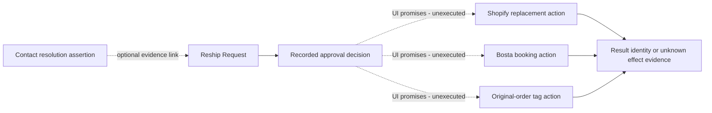

# Events, assertions, actions and projections

Evidence: [Phase 1 data](../reconstruction/07-data-model-observations.md), [metrics](../reconstruction/06-calculations-and-metrics.md), [workflows](../reconstruction/04-workflows-and-state-machines.md), [live ledger](../../evidence/live/observation-ledger.md). Classifications below do not prescribe event sourcing or storage.

## Persistent does not mean factual occurrence

A **fact/event** is an independently evidenced occurrence, scoped to what the source establishes. A **source assertion/observation** records what a system/person reported; it may be incomplete, disputed or a current-state snapshot. A **business action record** distinguishes intent, decision and external effect evidence. A **projection** applies a named rule to these inputs. Retaining a projection does not turn it into an occurrence.

An export proves that a value was recorded, not the underlying physical or financial event. “Called at” and caller text may be assertions with uncertain provenance. A tag observed today does not provide the date consent was obtained. These distinctions apply even when a source calls a field an event or outcome.

| Observed representation | Canonical classification | Permitted meaning / prohibited inference |
|---|---|---|
| Order placed date/header | Order source assertion; actual placement event only with event evidence | Preserve source time/precision; do not claim imported creation timestamp is necessarily first commercial occurrence. |
| Shopify payment/fulfillment/cancel/archive values | Source-state assertions, separately dimensioned | Cancellation assertion can coexist with return/outbound evidence; payment is not pickup collection. |
| Tags / manual `confirmedBy` | Confirmation Evidence observations | May support displayed attribution under a policy; no fabricated actor, consent contents or confirmed timestamp. |
| Actual consent contact, if later evidenced | Confirmation occurrence linked to Contact Event | Distinct from failed attempt/tag observation; current baseline lacks exact occurrence history. |
| Bosta tracking/type/state/dates | Leg identity plus reported type/state/time observations | A source courier event is factual only at the evidenced source grain; current snapshots do not reconstruct the entire transition history. |
| Courier Attempts | Reported counter on Leg | Separate from E09 event history. Excess attempts `max(0,count−2)` is a historical projection, not fee evidence. |
| 239 call export rows | Contact Events as recorded, with uncertain physical/timestamp/actor provenance | Preserve each recorded event and legacy vocabulary. `Last call` is a projection. Intake cumulative counters remain summary observations. |
| Reason/root cause | Recorded classification with taxonomy/source/actor | Customer explanation, courier exception, governed root cause and blamed owner are distinct. A later taxonomy mapping is a derived classification, not proof of the historical cause. |
| `ResolvedByCall`, `Called done`, `Refunded`, refund Yes/Partial | Contact/action assertions | Do not prove actual service closure, successful reach, amount refunded or payment execution. PD06/PD24. |
| Reship request/approval | Request and decision evidence; distinct External Business Actions | UI promise and original tag do not prove successful Shopify creation plus Bosta booking. Existing linked orders establish only evidenced result identities. |
| Pickup Collected (inferred) | Historical inference projection | Retain inference predicate/window, not a physical collection event. Live paid/waiting disproves universal payment equivalence. |
| Wallet/cash-cycle row | Courier Wallet Observation, a named source-assertion bundle distinct from Fee Record | Preserve COD/online/net, fee components/total, payment status/time and cash-out grouping. Recorded Paid does not prove bank settlement/customer refund. Tracking is subject reference, not universal entry identity. |
| Fee/component/aggregate amount | Monetary charge observation, actual versus modeled/component/aggregate provenance | Missing fee is not zero; component and total views are not additional independent charges to sum together. Assessed fee does not prove settlement. |
| Tracking-keyed intake row | Contact Intake Summary value object at source-row/revision grain | Retain cumulative support-contact counter, narrative, reach/cause/resolution/refund/recoverability assertions/blanks. Counter and Date do not reconstruct individual contact events or courier attempts. |
| Product stock now / ending stock / incoming | Inventory Observations at different scopes/times | No inferred movements or saleable returned inventory; native variant/location scope unresolved. |
| Weekly manually entered product row | Product-Period Snapshot with reported inputs and derived outputs | Same-week overwrite is UI contract; retain observation revisions canonically, not invented historical versions. |
| Own/generic product spend | Source spend assertion plus derived allocation | Allocation is not a new incurred expense or factual ad interaction. Native lineage may be unavailable. |
| Assigned tier / suggested tier | Recorded classification / calculated recommendation | No automatic tier transition inferred. Recommendations retain inputs and policy/as-of. |
| Queue issue / operational exception | Derived predicate or original exception assertion | Queue appearance/clearance is not automatically a Task assignment/closure event. |
| KPI value / report comparison | Projection, possibly retained with definition | Never store or describe a delivery rate as a customer/courier event. Different grains/periods remain incomparable until PD01. |

## Minimum provenance semantics

Each recorded assertion/event/result should retain, **when known**:

1. Merchant and subject identity, including unresolved source references.
2. Source Context, source object/file/sheet/cell/row or visible route/evidence locator and original value.
3. Source occurrence/effective time, source observation time, capture/import/recording time and calculation/rebuild time as distinct clocks. Unknown timezones and date-only precision remain explicit.
4. Actual actor, claimed actor and recording/importing actor independently; unknown is permitted.
5. Evidence certainty, derived/proxy/actual classification, and relevant definition/policy/source version. Classification observations distinguish original category from later responsibility/trust mapping; responsibility category is not a Task assignee or Membership.
6. Correction/supersession evidence and original values. No fabricated revisions beyond retained evidence.

This is proposed canonical provenance, not a claim that the current system retains every field. PD08/PD21/PD22 settle authority, effective revision selection, finality and retention.

## Projection contracts

| Projection | Grain / inputs | Supported definition and remaining decision |
|---|---|---|
| Order outcome | One Order, related leg types/states, channel/source status evidence | Current sampled RTO and customer-return cases distinguish leg completion from kept goods. Historical any-RTO priority is preserved as a named legacy rule; current multi-leg/chronology/null fallback is PD09. |
| Operational stage | One Order, handoff/booking/final-outcome evidence | Broad transit 47 includes 18 explicit transit plus 29 status fallbacks (D05). Preserve “unfinalized handoff stage” distinction without claiming exact predicate verified. |
| Confirmation attribution | One Order, tag/manual evidence | Current tag mapping Omar first; Confirmed+Confirmation Sent→Whapi; otherwise Confirmed→Hadeer (BR05). Manual precedence and chronological/actor truth PD08/PD19. |
| Return call eligibility | One eligible Order/Return subject, recorded contact history and cutoff policy | UI two-NoAnswer rule/current queue scope known; later event precedence, answered selection, escalation and retries PD05. |
| Cause distribution/call coverage | Deduplicated return population under named period/cohort | 102 returns/93 called differs from 239 events. “Each return once” UI contract does not resolve Return Case identity or first/latest reason (PD01/PD18). |
| Repeat-phone indicator | Order association with a source phone key and return predicate | Not distinct customers/people. Phone normalization and returned-state definition PD12/PD09. |
| Pickup state/success/no-show | Pickup/order collection/cancel/payment evidence under named rule | Historical paid-inference differs from live physical waiting. Current 44 collected includes one refused exception; completion/denominator PD03/PD01. |
| Cleanup issue | One order/category, current assertions, period and age origin | Categories/10+ placed-date age verified as UI; clear conditions unexecuted. Optional tidy differs from actionable issues. PD06/PD08. |
| Product performance | One Product and selected interval, sales/discounts/returns plus spend allocation | Verified current arithmetic: `(gross − discounts − returns) / (own + generic spend)` for 14 positive-spend rows; zero-spend ROAS blank. Definition/window/VAT/source lineage PD01/PD14. |
| Product advice / suggested tier | Product, exact sales/stock/spend/economics/season observations and policy | Suggested differs from assigned; velocity/graduation/rounding/replenishment algorithm incomplete. PD04/PD14/PD23. |
| Historical contribution | Leg/order-aligned values, costs/fees and explicit assumptions | Catalogue margin, positive fee acceptance and Paymob 1.7% heuristic are historical definitions; not audited profit/current approved economics. PD07. |
| Quality/report eligibility | Source completeness/joins/taxonomy and named gate policy | Historical CLEAN/CAUTION/BLOCKED/stop-reconciliation is intended reporting governance; live equivalent not verified. PD01/PD08. |
| Report review/approval assertion | Authored report content/revision and responsible review evidence | Historical intent/current DRAFT wording requires Operations review before forwarding (BR24/L26); quality eligibility alone is not approval. Proposed approval attribution references the reviewed revision; no stored approval or send action verified. |

Projection identity includes **subject/population, grain, time window, calendar, input source/revision, method/policy version, null handling and as-of**. Without these, two identical labels cannot establish comparable metrics. Unknown definition is explicit rather than replaced by a “standard” rule.

## Chronology

Seven recorded calls precede their matched order dates. Preserve both values and the contradiction; do not reorder timestamps, force to zero, relink by phone, or enforce a false chronological history. Historical cycle-days clamping to zero is recorded computation, not repair of the source date. If no occurrence time exists, ordering by observation does not imply physical event order.

Confirmation before dispatch is historical intended policy; absence of a confirmation timestamp prevents proof. Order placement, leg creation/completion, fee assessment/completion, call occurrence, pickup collection and product period are different date bases. Cairo-day labels and Phase 1B displayed watermarks remain scoped evidence; do not assign a timezone to every historical date.

## Monetary provenance

Keep **order commercial value, courier COD, cash collected, gross sales, discounts, customer refund/return value, supplier unit cost, assessed courier fee, modeled fee, ad spend and allocated spend** distinct. Record EGP where sourced; a default currency cannot fill unknown transaction currency silently. FX and other-currency product behavior are unresolved.

Historical COD→SKU subtotal→AOV proxy chain is a valuation method with provenance. AOV proxy is not a sale, fee, collected cash or refund. The entire wallet's EGP 134,233.55 and shipment-joined EGP 55,951.05 have different populations; neither silently substitutes for the other. Allocation portions are views of spend, not amounts to add to the original spend again.

The retained [RAW_Costs profile](../../evidence/artifacts/workbooks/02_Gentry_Delivery_Performance_System.data_profiles.json), `RAW_Costs!A/O:P/Q:AF/AG:AJ`, contains Business ID, COD, Online Payment Amount, fee/discount/credit/VAT components, Total Fees, Net Value, Payment Status, Paid At and Cash-out ID. The 1,381 source rows include Paid/Not Paid assertions and 78 distinct cash-out references. Preserve these as Courier Wallet Observations independently of Fee Records. Do not reconstruct a bank settlement, gateway transaction, customer refund or net-value calculation from field labels. Fees/components and their aggregate are alternative monetary views with unresolved reconciliation semantics (PD07/PD24).

## External-action consequences

The diagram is an evidence distinction, not execution sequence or architecture. One known result must not imply the other effects. Unknown receipt/timeout/duplicate effect remains unknown. Repeated receipts can describe one result, while one intent can produce multiple independently evidenced unintended results; neither count is inferred from retries alone. PD10 must approve business intent identity, duplicate-consequence handling and partial-effect responsibility before later implementation.
