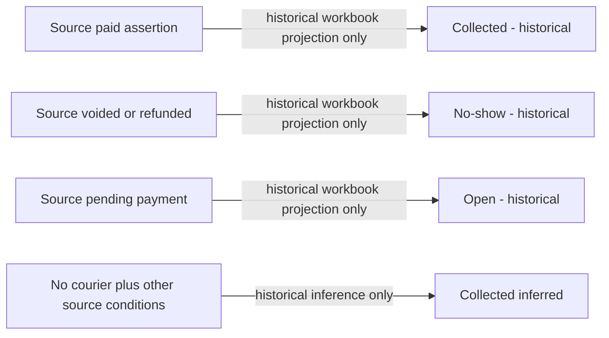
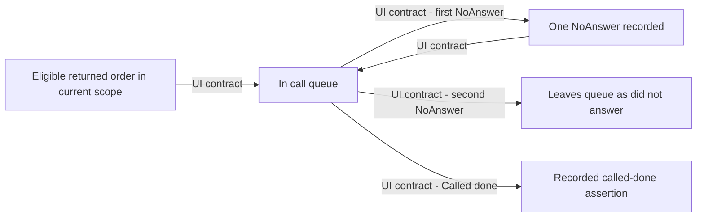
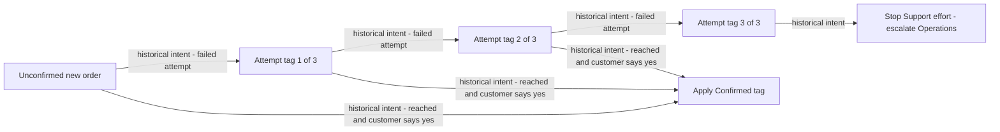
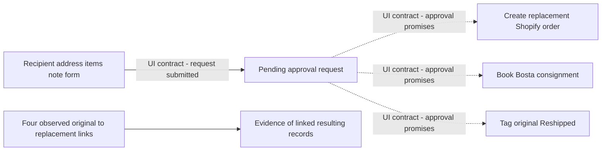
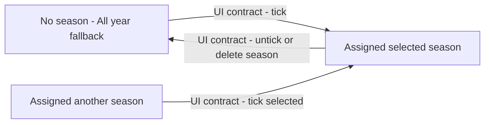
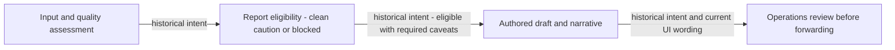

# Conceptual state machines and evidence limits

Phase 1 [workflow fragments](../reconstruction/04-workflows-and-state-machines.md), [rules](../reconstruction/05-business-rules.md), [live ledger](../../evidence/live/observation-ledger.md) support the following extent. **No production mutation was tested.** Observed states do not establish allowed edges. Where edges are unknown, the canonical machine is explicitly partial; no conventional e-commerce transitions are inserted.

Diagram edge labels state source scope. “Historical intent” and “UI contract” are verified statements of intent, not proved current enforcement. Proposed representation dimensions are separated from supported transitions.

## Order

There is no justified one-dimensional Order machine. Canonical dimensions:

| Dimension | Evidence vocabulary / meaning | Transition support |
|---|---|---|
| Commercial/display status | Pending, Cancelled, Completed | States observed in CSV; allowed/reverse edges and exact mapping to Shopify unknown. |
| Financial assertion | Paid, pending, voided/refunded and other source financial labels | Historical/live assertions; actual financial execution/precedence unknown. |
| Fulfillment assertion | Fulfilled/unfulfilled and source values | Observed detail/form; no business edge guards proved. |
| Channel | Delivery, Pickup; historical inferred/unfulfilled classifications | Source/current values; channel edit/transition policy PD08/PD18. |
| Confirmation | Tag/manual evidence and derived confirmer | See Confirmation; not equivalent to financial/fulfillment state. |
| Handoff / booking | Tag/checkbox signal versus matched courier consignment | Can disagree (L15); neither merges with physical transport. |
| Customer disposition/outcome | Kept, never received/RTO, post-receipt refused, exchange, pickup states, transit, blank | Derived projection; chronological/multi-leg rule PD09/PD03. |
| Operational stage | Not dispatched, pre-cancel, broad with-courier/unfinalized cohort | Projection; broad stage includes completed/cancelled fallbacks. |
| Archive / cleanup | Archive/source payment/cancellation assertions; issue membership | Clearing is UI contract; numbers-effect unknown except stated tidy claim. |

No diagram `Pending → Completed → Returned` is asserted. Return does not reverse commercial identity; cancellation may coexist with RTO. Review transitions only after PD08/PD09 and authoritative implementation/policy evidence.

## Shipment

Two independent source dimensions are established: type/purpose SEND/RTO/CUSTOMER_RETURN_PICKUP/EXCHANGE_return and courier state. Delivered describes that consignment, including reverse logistics.

Historical input states are terminal; live includes Processing/Created/Terminated and summary outcomes. No ordered state graph such as Created→Processing→Delivered is verified. Canonical Leg therefore records state observations and their original times without assuming every intermediate state, last-event dominance or terminal immutability. Leg-purpose changes, cancelled booking, RTO outbound pairing and reattempt edges are PD09/PD15/PD18.

## Return

Canonical Return Case separates **receipt disposition**, **reverse-logistics evidence**, **customer contact**, **service resolution**, and **financial assertion/effect**. The baseline establishes RTO versus post-receipt customer return versus exchange-return categories. It does not establish requested→approved→received→refunded transitions, a mandatory pickup leg, or saleable-stock restoration.

Return Case identity/episode and partial quantities remain PD18. Calls/refunds/reships can supply related evidence; none is a universal closing edge. “Resolved” is PD06 and financial execution PD24. A completed customer-return consignment can coexist with a cancelled order and unresolved service case.

## Pickup

Current observed states are waiting, collected, cancelled and the refused exception. Their physical transition guards/timestamps are unknown. Payment is a separate dimension, supported by paid+waiting at 21 days (L18).

This is the old classification, **not a physical collection machine**. Current waiting→collected, cancellation/no-show, collection→return and partial collection edges are `TBD — OWNER DECISION` PD03/PD18. Source call at 3 days/manual cancel recommendation at 7 and current cleanup at 10+ are distinct policy projections, not automatic transitions.

## Contact/call workflow

The factual record is Contact Event; the machine below is **queue eligibility as stated by current UI**, not mutation of a contact event:

L17 supports one-NoAnswer still queued. Prior answered/resolved/escalated then NoAnswer, no-status import, wrong-number/unreachable, re-entry/reopen and retry reset edges are unresolved PD05/PD06/PD16. No third-attempt return-contact cap is derived from the confirmation SOP.

Historical intended contact workflow preserves attempts/narrative and governs root cause only after Reached (BR07). Current `ResolvedByCall` versus legacy `Resolved` does not prove reached consent or completed action. Export/status taxonomy mappings require original labels plus governed mapping, not forced replacement.

## Confirmation

Historical intended process is sufficiently documented to show this fragment:

This does not prove current dispatch guard, actual event timestamps or automatic cancellation. Attempts are tags with replacement intent, not reconstructed contact events. Consent after escalation, withdrawal/reconfirmation and automation handling are unresolved PD19. Current tag attribution Omar/Whapi/Hadeer is a separate projection; it does not establish the path taken through this process. Manual confirmer precedence is PD08.

## Reship / replacement

The three promised effects have no verified ordering/atomicity. Approval/rejection controls on occupied request, denial, cancellation, failed/duplicate booking, partial execution and completion criteria remain unknown. No generic approved→completed edge is imposed. Canonical evidence dimensions distinguish request decision from each effect result; successful/unknown effects can differ without inventing a rollback policy.

Same COD is the observed contract, not a universal replacement-pricing rule. Reattempt/rescheduled delivery can use an existing order/leg; reship creates another order per UI. Exchange, replacement and repeated request relationship constraints remain PD10/PD17/PD18. Actual original-payment treatment is PD24.

## Product lifecycle and season assignment

Assigned tier vocabulary New/Scaling/Baseline/Underperformer/Clearance is observed. No automatic tier transition is established. Twenty assigned-New products with divergent suggestions support separating **manual classification** from **recommendation**. Product publication, discontinuation and deletion transitions are unknown.

Season assignment fragment is a current unexecuted UI contract:

Now/Upcoming is derived from dates, not a lifecycle action. Season overlap, temporal assignment history, restock arrival across start/end and assignment validity remain PD14. Current UI implies one assignment; enforcement unverified.

## Product snapshot / recommendation lifecycle

Manual snapshot form→weekly history and same-product/week overwrite are UI contracts (BR22). Existing seven rows establish multiple weekly observations, not previous revisions. Canonically, a new observation/revision preserves old evidence and separately identifies the current selected revision; this is a **PROPOSED CANONICAL INVARIANT**, not an extra observed Gentry transition.

Recommendations are projections, not entities with an invented approval lifecycle. Rebuild with revised input may change advice; accepting advice is not proved by assigned-tier equality. Graduation at 20 orders is guidance; progress window differs from current all-time count and remains PD14. No automatic purchase/production action follows advice. Exact revision authority/finality/overwrite is PD08/PD21.

## Report eligibility and human review

Historical Data_Quality CLEAN/CAUTION/BLOCKED and channel-reconciliation stop govern whether/how a report is eligible to be prepared (BR16). **Eligibility is separate from Operations review before forwarding** (BR24). Current printable brief is DRAFT with Operations-approval wording (L26); persistence, approval execution and actual sending were not verified.

No completed approval or sending transition is asserted. Canonically, any retained review/approval assertion identifies the reviewed report content/revision, actor attribution, decision/time if known and applicable quality basis. This revision attribution is a proposal; an edited narrative is not silently covered by an older approval. Current narrative persistence is unknown. A Report entity or automated communication lifecycle is not introduced; actual approval/forwarding evidence remains PD08/PD11/PD22.

## Unsupported edge register

The model deliberately leaves unknown: dispatch enforcement; shipment reverse/terminal transitions; physical pickup completion; return episode splitting/closing; call re-entry/precedence; approval/rejection/failure recovery; product retirement; financial refund execution; snapshot finality. Each has a policy/evidence question in [07](07-policy-decision-register.md) and [09](09-open-domain-questions.md). A vocabulary node is not an allowed edge and a historical instruction is not current server enforcement.
