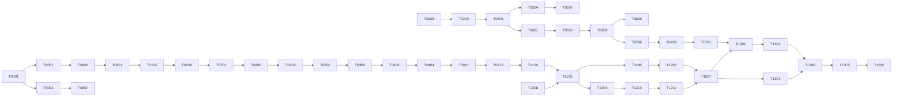

# Implementation dependency graph

Plan P6-r2. The full [task DAG](dependency-graph.mmd) has 127 nodes; [topological order](task-order.json) is authoritative data derived from the manifest. Every edge consumes the predecessor's versioned boundary and acceptance evidence, not merely its source files.

This compressed diagram shows selected transitive relationships; exact direct edges are in the full DAG/manifest. There is no duration estimate. Structural bottlenecks are tenant isolation, atomic queue qualification, source/run identity, contact/action recovery, complete golden realization, qualified real reads/actions, staged recovery, private rehearsal, shadow and authority transfer.

Milestones organize outcomes and are not whole-milestone prerequisites. T1201–T1204 may establish controlled staging before M3/M4 read qualification; local work can continue while those authorized-environment tasks wait. M11 private rehearsal consumes M12 staged recovery, while M12 shadow consumes that rehearsal. These are acyclic task edges, not permission to pretend every milestone finishes in number order.

After a predecessor merge, each consumer branch updates from accepted main and revalidates the produced contract/version. A future release gate is not an invented task dependency on an owner decision.
