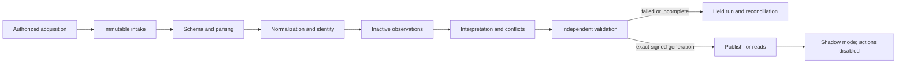

# Logical migration pipeline and Migration Run

## MP-ACQ01 — Acquisition closure is separate from intake conservation

“All returned pages succeeded” proves traversal, not a closed provider population. Each source qualification must describe stable snapshot or sorted cursor semantics, upper cutoff/timestamp ties, native revision/child pagination, update visibility bounds, cursor expiry/restart, initial-to-incremental buffering, and authoritative withdrawal/removal evidence. Select a qualified method; do not assume the provider supplies a snapshot or a maximum delay.

Against an independently enumerated synthetic source inventory, move an object across an already-read page boundary, add an exact-cutoff-timestamp object, deliver an earlier-timestamp update late, change/remove a nested line and expire a cursor. Expected current set/revisions must reconcile exactly, with prior assertions retained and qualified removals excluded from current selection. Absence in incomplete/inaccessible listing is not deletion. If no bounded closure can be proven, state uncovered scope and hold continuity-dependent activation; repeated successful reads alone do not certify completeness.

**MP-T10/PC-C01:** [changing_capture](../../evidence/migration/golden-logical-fixtures.json) expects N01@v1,N02@v2,N03@v1,N04@v1 and explicit LINE-OLD withdrawal. Test independently known missing identity even when received row counts match. Old open work outside the optional history horizon needs its own closure evidence.

## MP-SEED01 — Inherited migration safety manifest

Before any authority/contact transfer, independently retain a minimal versioned **migration-safety-seed** in the existing protected recovery storage. It records run/snapshot/policy digests, merchant/verified native account, old/new native/canonical business scopes, inherited unknown/succeeded-effect reservations, issued manual handovers, consumed/uncertain contact allowances and incompatible live episodes. Unknown historic actor/time stays unknown; current acceptance actor is distinct. Missing native scope expands quarantine; it does not omit the restriction.

Verify durable seed creation, complete enumeration/coverage, protocol version and retention spanning every restorable backup plus unresolved holds. A restore before migration must recover inherited restrictions even with **zero OpsHub dispatch/contact markers**. Seed issuance/publication uncertainty blocks transfer. It adds a bounded recovery descriptor, not a second general event store. See RV19.

## MP-PRIV01 — Privacy suppression on every replay

Consult current authorized source-scoped privacy dispositions before intake accessibility, normalization/interpretation and publish, including identical snapshot replay, changed parser/mapping, late API/webhook receipts and old-generation exports. A completed redaction cannot reappear through a new observation/run. Restricted historical evidence is retained only under approved minimized hold policy; no customer fields become accessible because the file is “immutable.” Suppression keys/native references are protected data. Ambiguous suppression scope holds affected publication pending approved mapping; no phone-based cross-tenant deletion. Source/ is not changed in this phase.

**MP-T11:** complete redaction, replay old snapshot under same and changed importer, process late receipt, export retained generation. Required privacy fields remain inaccessible across canonical data/projections/downloads; justified minimal reservation knowledge survives.
**Contract only.** Use the approved [inbound/action/reconciliation separation](../architecture/05-integrations.md) and [transactional checkpoints](../architecture/07-background-jobs-and-reconciliation.md). No implementation or SQL is supplied.

## Stage contract

| Stage | Input → output; validation/failure boundary |
|---|---|
| MP01 source acquisition | Authorized source/account/scope/interval → minimized acquisition manifest; prove all pages and coverage, record inaccessible range. No live writes |
| MP02 immutable intake | Original capture → private snapshot, digest/version/byte count/object/row count, custody and privacy class. Do not overwrite source/ or existing evidence |
| MP03 schema validation | Snapshot → supported contract/version and file safety verdict. Unsupported/truncated/corrupt files held/rejected explicitly; whole-file rejection still has known/unknown unit accounting |
| MP04 parsing | Eligible snapshot → original row/object/group observations with stable locators. Header/continuation relationships and actual occupied cells retained |
| MP05 normalization | Original values → typed candidates plus original/precision/timezone/null metadata and warnings, under versioned rules |
| MP06 identity resolution | Candidates → verified/reviewed bindings, collisions and unresolved subjects. No phone/name/SKU global match |
| MP07 observation ingestion | Source facts/corrections → tenant-scoped assertions and dispositions in inactive run scope; no current-operation promotion |
| MP08 canonical interpretation | Accepted evidence + approved policies → staged canonical changes, cases/holds and projections, each with basis and input versions |
| MP09 conflict detection | Competing assertions/grain/cardinality/source gaps → conflict register, impact and activation exclusions; no last-write-wins |
| MP10 migration validation | Staged generation → conservation, identity, domain, golden/KPI and oracle reconciliation; approvable report or failed/held run |
| MP11 publish/activate | Exact validated manifest/generation + current Admin sign-off → atomic merchant-visible generation or coordinated verified publish boundary. Action capability flags remain off |

No partially validated generation becomes active operational truth. Pages may commit inactive evidence and durable safe work, but only the final validated scope is activated. If a staged proposal changes an existing active merchant, validate against the captured active revision; drift requires recomputation/review, not overwriting current state.

## Migration Run identity — MRUN01

A Migration Run has opaque run ID, merchant, environment, source context/native account, parent bundle ID, requested/actual coverage, source snapshot ID/version/hash, parser/schema/importer version, normalization/identity/source-authority/configuration/definition versions, current active revision, start/end/checkpoints, recording User/Membership or automation origin, state, row/object/group counts, disposition IDs, warnings/errors/conflicts, produced/bound canonical IDs and selected interpretation generation, validation report/digests/outcome, approver/authority/time and activation manifest.

Use a bundle for multi-source pilot activation: explicit child runs, compatible source cutoffs, dependency graph and a reconciliation manifest. Different source observation times need declared skew/coverage; not a fictitious globally atomic provider snapshot.

Run states: Planned → Acquiring → IntakeComplete → Staging → ValidationPending → Validated or Held/Failed → ApprovedForActivation → Activated. Superseded and Withdrawn are retained states. Completed acquisition is not Validated; Validated is not activated or action-authorized. Authority or policy changes invalidate unstarted approval.

## Restartability and idempotency

Replay identity includes merchant/environment/native namespace/snapshot digest/importer/mapping/configuration versions. Identical input + versions gives the same effective staged result and canonical bindings, with a separate replay-attempt receipt as needed. Run UUID itself is not the dedup key. Exact provider object revision reobservation is a no-op for canonical change, while evidence-capture lineage can be appended.

Commit one group/page's dispositions, accepted observations, consistent staged changes and safe work atomically **before** advancing its checkpoint. Crash before commit repeats the group; crash after commit before acknowledgement discovers existing completion. Never checkpoint an unaccounted row. Parsing groups can span pages/files; incomplete Order headers/lines stay held until complete.

Changing mapping/importer/source policy creates a new run referencing prior run/snapshot, not an overwrite. Reuse verified subject identities; append new assertions/interpretations, preview deltas, validate all affected contributor sets and dependent approvals. Concurrent same-scope runs cannot both publish a current pointer. Activation uses a compared active revision and durable manifest; restart observes whether that exact generation published, not a second activation.

## Inbound does not replay history

Imported “booked”, “cancelled”, “reshipped”, “refund issued” or “resolved” assertions may establish a qualified observation/result with native reference. They do not create a fresh approved executable effect. Imported unknown actions create holds with recoverable business scope. Missing old execution/authority records are not fabricated. Historical contact allowance is reconstructed only from qualified events/counters/independent holds; uncertainty blocks new contact starts pending reviewed policy.

## Failure, rollback and re-import

Before activation, withdraw staged selection and isolate failed runs; preserve snapshots/dispositions/evidence. If evidence was safely appended to shared records, exclude its interpretations rather than delete truth. After read activation, rollback can select a prior validated generation only if newer canonical evidence/corrections/holds/privacy are preserved and exposed correctly. It cannot erase an action that happened afterward.

Corrected mapping re-run lists old→new bindings, interpretation deltas, excluded/added contributors and old report references. Superseded observations retain lineage/retention holds. External effects are never rolled back by importer replay. [13](13-cutover-and-rollback.md) governs application versus business rollback.

Future fault tests MP-T01 crash at every stage; MP-T02 repeat identical snapshot; MP-T03 changed mapping same data; MP-T04 invalid final row; MP-T05 multi-source child failure; MP-T06 active revision changes during approval; MP-T07 duplicate concurrent publish; MP-T08 fail after pointer commit; MP-T09 privacy redaction during staging. Expected: complete accounting, no unvalidated activation, stable bindings, retained prior evidence and zero external mutation.
