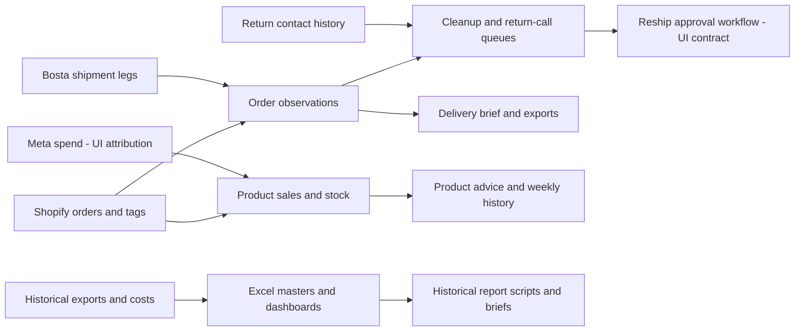

# Gentry reconstruction — review entry point

As inspected on **13 October 2026**. This package reconstructs the supplied artifacts and the authenticated Gentry Ops application. It does not specify a replacement product. It is ready for a first human review; full end-to-end verification remains bounded by the available role, absent backend source, and read-mostly production access.

## Reading and evidence standard

- **VERIFIED**: direct evidence, always scoped to artifact contents, displayed UI, downloaded data, or independent arithmetic.
- **INFERRED**: supported interpretation without direct verification.
- **UNRESOLVED**: contradictory or insufficient evidence.
- A visible form or stated side effect is a **verified UI contract**, not proof of successful execution or server authorization. A historical intended rule is not proof of current enforcement.

Primary evidence: [live ledger](../../evidence/live/observation-ledger.md), [workbook analysis](../../evidence/artifacts/workbooks/WORKBOOK_FINDINGS.md), [text/script analysis](../../evidence/artifacts/text/nonworkbook-analysis.md), [source hash baseline](../../evidence/source-manifest-before.json). Locators in the text analysis refer to original Markdown/code lines or DOCX paragraph/table order. Workbook locators use sheet and cell/range. Evidence profiles retain aggregates and schemas, not customer contacts or credentials.

**Phase 1B technical pass completed:** [technical ledger](../../evidence/live/phase1b/technical-ledger.md) adds delivered Next/Flight/action evidence, public HTTP observations, permission metadata, product report/print wiring and a September export. The authenticated network/backend gap is partially closed; actual traffic, server enforcement and refresh implementation remain unverified. The accepted baseline is preserved, and no replacement design follows this pass.

| Review area | Documents |
|---|---|
| Evidence and traceability | [01 Sources](01-source-inventory.md), [12 File-to-feature links](12-file-to-feature-traceability.md) |
| Product and domain | [02 Features](02-feature-inventory.md), [03 Domain](03-domain-model.md), [11 Routes](11-ui-route-map.md) |
| Behavior | [04 Workflows](04-workflows-and-state-machines.md), [05 Rules](05-business-rules.md), [06 Metrics](06-calculations-and-metrics.md) |
| Data and operations | [07 Data](07-data-model-observations.md), [08 Integrations](08-api-and-integration-observations.md), [09 Permissions](09-roles-and-permissions.md), [10 Ingestion/jobs](10-data-ingestion-and-background-jobs.md) |
| Human review | [13 Discrepancies](13-live-vs-spec-discrepancies.md), [14 Questions](14-open-questions.md), [15 Migration risks](15-saas-migration-risks.md) |

## Observed system

**VERIFIED historical artifact model:** a single Gentry apparel operation joins Shopify order line exports, Bosta shipment legs, Bosta wallet costs, a Google Sheets return contact log and SKU price/cost data in Excel. It produces operational queues, delivery/return/cost analysis, confirmation and pickup metrics, and authored executive/operations briefs.

**VERIFIED current visible model:** an Order Performance section combines order, courier, confirmation and call information, offers cleanup queues and reship requests, and exports orders/calls. A separate Product Performance section combines sales/returns, ad spend, stock, margin-based advice, weekly snapshots and seasons. These product-management features have little implementation specification in the supplied historical package.

Arrows describe observed information dependencies or UI claims, not proven service architecture.

## Coverage

| Area | Coverage / limits |
|---|---|
| Original artifacts | All **38 files** inventoried; eight readable XLSX workbooks, one XLSX lock file, one CSV, 28 other artifacts. All meaningful sheets, formulas, controls, scripts, SOPs, report bodies and version relationships inspected. Lock file and bytecode identified as generated. |
| Source execution | Seven Python sources statically parsed; source scripts/macros not run. Current/v3 formula caches absent; independent reproduction is not an Excel-engine run. |
| Live navigation | Both visible sections; dashboards, lookup, calls, cleanup, reships, add order, printable brief; product dashboard, detail, add, settings, seasons and assignment, New queue. Desktop/mobile navigation and home checked. |
| Live data | Orders all-time export: 1,339 rows; call export: 239 events; product export: 20 rows. Schema/aggregate arithmetic checked. Several contrasting order states and one product detail traced. |
| Validation / errors | Native form attributes and option sets; safe no-match search; empty approval queues. Server validation and failure/retry behavior not exercised. |
| Writes / integrations | No production mutations. Reship, import, refunds, cancellations, settings and approval effects remain UI contracts. Sync markers changed without manual sync. |
| Roles / backend | One Omar session; permission props and one unauthenticated server redirect verified in Phase 1B. No second-role matrix, backend source/schema or authenticated network trace. Delivered action/protocol contracts are captured; no separate Production route exposed. |
| Second pass | Broad “in transit” cohort, outcome export gaps, call-event chronology, pickup exception, season assignment, refresh timing, historical-only financial logic and live-only product rules reconciled. |

## Highest-confidence findings

1. **Orders and shipment legs have different grains.** Shopify name joins Bosta business reference; wallet/intake tracking joins a shipment. Current source has 1,635 order headers versus 569 shipment legs. Multi-leg orders exist.
2. **Current web cohorts differ from source history.** All 353 v3-backup orders overlap live with identical placed dates. Current workbook shares 768 of 1,635 headers with live; 867 source-only orders span 1 April–1 June, while 571 live-only orders span 8 September–13 October. Some source-only dates overlap the live date range, so a simple cutoff does not explain every omission.
3. **Live outcome, order status and operational stage are separate dimensions.** The47-order With Bosta in transit stage includes18 transit outcomes, 19 Cancelled and10 Completed. Twenty-nine CSV outcomes are blank despite status labels rendered in UI.
4. **Confirmation is tag-derived attribution.** Omar/Hadeer/Whapi are separated by current displayed tag rules, while historical coverage groups Hadeer/auto and excludes Omar. No confirmed timestamp establishes pre-dispatch chronology.
5. **Live product ROAS arithmetic is reproducible.** All 14 positive-spend rows match net sales after discounts/returns divided by estimated own+generic spend. Assignment remains New despite suggested tier.
6. **Source financial/report logic has important provenance limits.** Master formulas, monthly extractor and authored report do not use identical definitions; original source stays preserved.

## Important contradictions and gaps

- June coverage explanation changes from complete/onboarding pickups to incomplete paginated courier export. Current workbook's mismatched time windows make inferred pickups unsafe as proof of collection.
- Paid pickup is historically inferred collected, but a sampled paid live pickup remains waiting at21 days.
- A handoff tag marks a live order dispatched while its courier card says not dispatched; stage totals include status fallbacks. Export/UI reconciliation needs an explicit outcome contract.
- Historical coverage numerator, retry policy, return taxonomy, week start and pickup targets differ from current surfaces.
- Monthly report code can overwrite duplicate fees, zero missing money, count every SEND as delivered and classify partialness from execution month. Some defects are latent: current wallet keys are unique and all current SEND rows have Delivered states.
- Calls have imported/historical values absent from the current form; seven exported event dates precede matching order dates. Attribution, clock and linkage need checking.
- Production refresh changes numbers during inspection; dated screenshots or outputs without a watermark can be mistaken for contradictions.

Details: [discrepancies](13-live-vs-spec-discrepancies.md), [questions](14-open-questions.md), [migration risks](15-saas-migration-risks.md).

## Confidence and review gate

**High:** file identity, historical source intent, static script behavior, visible route/form vocabulary, exported populations, verified arithmetic. **Moderate:** current operational rules described by UI and source-to-live conceptual mapping. **Low / unresolved:** enforced transitions, mutation side effects, temporal attribution, exact suggested-tier/restock algorithms, integration pagination/idempotency, job implementation and access control.

Recommended review: Operations and the owner review the discrepancy/question tables, confirm current metric definitions and policy authority, then authorize a small nonproduction test set and other-role inspection. This reconstruction should be corrected from that evidence before any replacement PRD, tenancy design, technology selection or implementation begins.
