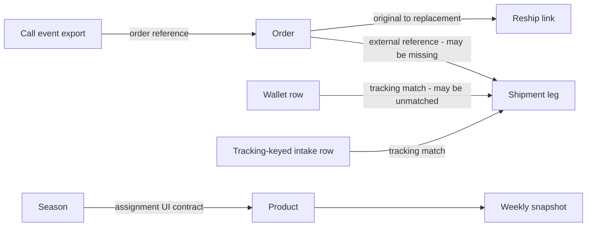

# Domain model reconstructed from evidence

This is a conceptual model of Gentry's existing operations. It is not a proposed database schema. Evidence: [workbook analysis](../../evidence/artifacts/workbooks/WORKBOOK_FINDINGS.md), [text analysis](../../evidence/artifacts/text/nonworkbook-analysis.md), [live ledger](../../evidence/live/observation-ledger.md).

## Entities, grains and identities

| Concept | VERIFIED observations | Relationship / uncertainty |
|---|---|---|
| Merchant | One named Gentry apparel business across artifacts and current app. | No merchant/tenant selector, partition identifier or cross-merchant behavior verified. Multi-tenancy is an intended future concern only. |
| User / operator | Authenticated Omar display name; call caller field and history include staff labels. Historical roles Support/Operations/Owner. | Caller can be free text; it is not proved to be a user FK. “Team” chrome label does not establish RBAC privileges. |
| Customer | Shopify/Bosta contacts and order customer labels. Source repeat logic uses phone. | Phone can vary and is not proved unique/normalized. Live repeat flag counts associated orders, not distinct people. No canonical customer table proved. |
| Order | Historical unique Shopify Name/order reference; RAW_Shopify line grain becomes one Orders_Master row. Live internal detail ID plus external order number; export1,339 unique names. | Order has placed date, channel, status, tags, confirmer, value and item summary. Name→Bosta business reference bridge; one order can have multiple legs. |
| Shipment / leg | Bosta text tracking ID, type, Created date, state, attempts, courier exception, COD and description. Historical569 unique legs/534 nonblank distinct references. | Many legs per order occur; four blank references. Live summary shows selected courier fields, not complete leg selection rule. SEND/RTO type and current state are independent dimensions. |
| Courier | Bosta is the observed integration and supplied export origin. | City/zone/courier-failure analysis exists; other couriers or configurable courier entity not verified. |
| Delivery attempt | Numeric attempt count in source/export; current export values include 0–7. | No event-grain attempt record/timestamps observed. Count is not proof of an enumerable attempt timeline. |
| Confirmation | Derived from Shopify tags, live Omar/Hadeer/Whapi/none. Historical Hadeer-or-auto conflation. | No timestamp/event ID establishes exact before/after dispatch chronology. Failed confirmation attempt tags are distinct from return contact attempts. |
| Return | Historical shipment types RTO/customer return/exchange; source call intake tracking key. Live derived order outcome plus return call/reason fields. | Not verified as a separate persisted return entity. UI semantics denote RTO as never received and refused as post-receipt; physical outcomes were not independently checked. Repeated legs can duplicate units/value. |
| Contact event | Live call CSV 239events/224 orders; status, reason, resolution, refund, recoverability, caller, notes, date. Source intake 75 rows with cumulative attempt count, no equivalent event timeline. | Call export has broader historical vocabulary; exact migration/linkage unresolved. Order Last call is a projection, not full event history. |
| Pickup | Current explicit Pickup channel with collected/cancelled/waiting/exception; historical recorded90Office and inferred unrecorded category. | Historical inference from paid/no courier does not prove physical collection; current paid-waiting example contradicts simple mapping. |
| Product / variant | Current20 products with Shopify Product GID/internal ID, metadata/tier/season/ad keywords. Historical60SKU labels/19 products; description matches variant string. | Shopify product versus variant versus parsed item label differ; exact ID crosswalk/variant stock grain unresolved. |
| Product period / snapshot | Live manual weekStart, units, sales, discounts/refunds/spend/endingStock/cumulativeOrders; seven rows in sampled detail. | UI says same-week overwrite; uniqueness/version/audit and sync-versus-manual precedence not verified. |
| Season | Current named start/end record with internal ID and assignment checkbox UI; one season per product implied by move/untick text. | Cardinality is UI contract; overlap/date validation not executed. All year is displayed fallback, not proved stored season row. |
| Ad / spend allocation | Names/keywords associate ads to products; own versus generic estimated spend, Meta incl VAT copy. | Multiple match collision, currencies, VAT rate, daily/week allocation edges and event provenance unresolved. |
| Cost / wallet line | Historical tracking-key cost ledger; positive Total Fees summed by master; SKU supplier cost; gateway1.7% assumption. | No current live financial ledger or fee import inspected. Monetary assumptions are historical Config values. |
| Reship request / replacement | Current request fields and pending-approval queue; four original→new order histories. | Approve creates external records per UI; request states/idempotency/cancel/refund effects not executed. |
| Exception / task | Courier exception strings, data-quality flags, cleanup categories and queue memberships. Historical report action-sidecar entries. | A computed queue is not necessarily a persisted task. No application audit/task table established. |

## Relationship diagram

Arrows describe join or display relationships, not mandatory foreign keys. Four source legs lack an order reference and 812 wallet rows have no shipment match. Current intake is one row per unique tracking key with a cumulative attempt count; the supplied join takes the first match. Multiple fee lines are allowed by the summing rule, but multiple intake rows are not established. Live item entity IDs were not inspected.

## Separate dimensions that must remain separate

1. **Placed order vs courier leg vs fee completion vs call event vs product period.** Their date windows and denominators differ.
2. **Shopify status / fulfilment / payment vs derived outcome vs handoff stage.** Live Completed can fall in With Bosta in transit; cancelled orders can be RTO; a Bosta return leg can be Delivered while its order is refused.
3. **Human confirmation vs automation vs Operations intervention.** Exact tags infer attribution; they do not prove who contacted the customer.
4. **Customer narrative vs contact reach vs root cause vs resolution vs economic refund.** Recording a label is not executing its underlying action.
5. **Assigned tier vs suggested tier; current stock vs dated ending stock; period orders vs cumulative snapshot orders vs current all-time.**

## Canonicality assessment

**High-confidence business identifiers:** Shopify external order reference, Bosta tracking as text, Shopify Product GID. **INFERRED bridges:** live external references support integrations, but internal FK/key constraints are unknown. **UNRESOLVED:** normalization of phones/tracking/references, case-sensitive tags, migrated caller identity, shipment selection, historic product crosswalk and tenant scoping. These require verification before a future migration can preserve identity safely.
