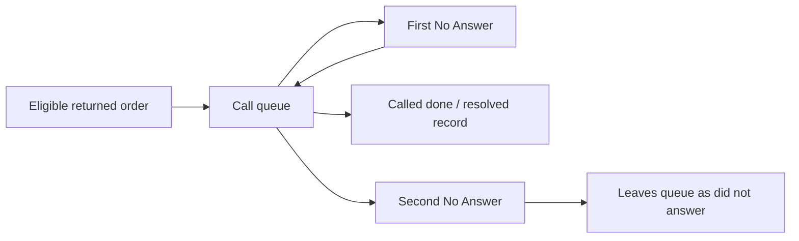

# Workflows and state machines

Evidence: [live ledger](../../evidence/live/observation-ledger.md) L04–L06, L12, L15–L18, L22, L26–L27; [source SOP/script analysis](../../evidence/artifacts/text/nonworkbook-analysis.md); [workbook formula findings](../../evidence/artifacts/workbooks/WORKBOOK_FINDINGS.md).

A state vocabulary is not a complete allowed-transition graph. Below, **observed** means an existing record or rendered cohort; **intended** means a source instruction; **UI contract** means a current displayed instruction. No production transition was executed. Blocking conditions not directly evidenced remain unresolved.

## Pre-dispatch confirmation — historical intended workflow

| State / trigger | Next state and side effects | Blocks / terminal / limits |
|---|---|---|
| New order, no confirmation | Support calls before dispatch. | SOP says every new order; no server dispatch guard proved. |
| Failed attempt1 | Shopify attempt tag1/3. | Do not mark Confirmed merely because a call was tried. |
| Failed attempt2 | Replace1/3 with 2/3. | Intended replacement, not extra independent event. |
| Failed attempt3 | Replace2/3 with 3/3, leave unconfirmed, stop and escalate to Operations. | Intended terminal for Support confirmation effort; no automatic cancellation established. |
| Customer reached and says yes | Apply exact Confirmed tag. | No confirmed_at field established in supplied final model. |
| Operations confirms | confirmed omar attribution takes precedence. | Intended distinct intervention segment; original plan's tag string is obsolete. |

**Current observed projection:** confirmed omar→Omar; Confirmed with Confirmation Sent→Whapi; other Confirmed→Hadeer. These tags establish displayed attribution, not successful call content, historical actor identity or temporal ordering. The current app's creation/edit form also accepts a confirmer directly; precedence between manually stored value and synced tags is unresolved.

## Order, dispatch and courier outcomes — current observed projections

Order status Pending/Cancelled/Completed, fulfilment, payment, handoff flag and courier outcome coexist. They are not one linear machine.

| Condition / observed example | Displayed result | What remains unknown |
|---|---|---|
| Delivery, no handoff, no cancellation | Not shipped yet / not-dispatched cohort. | Whether fulfilment or tag edits move the cohort, and required guards. |
| Delivery cancelled with no dispatch signal | Cancelled before dispatch cohort. | Which timestamp/flag has precedence during delayed sync. |
| bosta_synced tag, no stored type/state, cancelled | Dispatched checkbox true; courier card says Not dispatched yet; Outcome Cancelled. | Tag and matched courier evidence disagree; booking history and selected shipment lookup are unresolved. |
| RTO type, Bosta state Delivered, Shopify cancellation | Never received RTO. | Type takes precedence in sample; entire algorithm not proved. |
| CUSTOMER_RETURN_PICKUP, state Delivered, cancellation | Received then refused. | Delivered describes return-leg completion, not kept outbound goods. |
| No explicit final outcome, handoff present | Broad With Bosta in transit stage includes Cancelled/Completed fallbacks. | Stage may mean unresolved courier outcome rather than physical transit. |

The all-time terminal-outcome denominator is1,054=kept640+RTO339+refused40+exchange35. Eighteen explicit In transit and29 status-fallback rows are excluded from that denominator, but included in the47-order broad stage. No allowed reverse transitions or chronological last-leg rule was established.

Historical workbook algorithm differs: any matching Returned to origin beats any Delivered across all related legs, irrespective of chronological order or outbound type. Do not use that static priority as proof of current behavior.

## Return contact — historical and current

Historical SOP: uncalled return→attempt contact→Reached/No Answer/Phone Off/Wrong Number/Refused to Talk/Number Unreachable. Preserve narrative; increment cumulative attempts; only Reached may receive governed root cause. Resolution field may hold Pending, exchange requested/completed, refund issued, reshipped, customer lost, not recoverable. The SOP supplies no finite transition graph or No Answer retry ceiling; three attempts belong to confirmation.

Current UI contract:

These arrows are **displayed instructions, unexecuted**. One-NoAnswer sample remains in queue. Quick Called done records signed-in username and no detailed reason; detail form captures reason/resolution/refund/recoverability/caller/notes. Server requirements and contradictory combinations were not tested. Historic EscalatedToOmar events exist although not in current status dropdown.

Dashboard metrics deduplicate returns; exported calls are events. Queue32 versus uncalled9 is not automatically a contradiction: retry eligibility, periods and denominators differ. Which event marks the return called/answered, and whether later NoAnswer overrides a prior resolution, remain unresolved.

## Pickup shelf

Historical intended state: financial pending→Open; paid→Collected; voided/refunded→No-show. Age is measured against maximum exported order date; call flag3 days, manual cancellation recommendation7 days. Inferred paid/no-courier pickups are separate Collected(inferred), excluded from no-show denominator.

Current observed state: Pickup waiting, Picked up, Cancelled and one refused exception. A paid pickup at21 days remains waiting; no-Bosta is normal for pickup. Dashboard waiting age bands <3, 3–6, 7+. Cleanup escalates10+ based on placed date. Current collection trigger and financial/status precedence are unresolved. “KILL” in the workbook and cancel links in live UI do not establish an automatic transition.

## Reship request and approval

1. Current detail form collects recipient/phone/city/address/items/note; UI states same COD as original.
2. Request waits for Omar approval. Pending list was empty; history shows four completed original→replacement links.
3. UI says approval creates Shopify replacement payment-pending order and a Bosta shipment, labels Reship of original, and tags original Reshipped.
4. Approval/rejection controls on an occupied request, blocking conditions, eligibility, duplicate submission protection, failure compensation and terminal states were not observed.

This is a partial reconstructed contract. It is materially consequential and was left unexecuted. The form's presence on pickup does not prove a pickup is eligible. Recording Re-shipped in a call form may be independent of the actual request/approval machine.

## Cleanup

Queue membership is derived from current Shopify/courier conditions. UI says cancellation, archival or refunded/voided payment clears an issue; completed-not-archived is a tidy category said not to affect numbers. These transitions were not tested. Monthly and Monday routines are human instructions, not proof of scheduled automated cleanup.

## Product tier, season and snapshot changes

- Assigned tier values: New/Scaling/Baseline/Underperformer/Clearance. Suggested tier and advice appear separately. All 20 remain New. Passing20 orders produces graduation guidance, not an observed automatic transition.
- Season membership UI: unassigned→All year; tick product→selected season, replacing previous assignment; untick/delete season→All year. Twenty checkboxes and required season dates observed; no mutation/overlap validation tested.
- Snapshot UI says same product/week overwrites earlier snapshot; required numerical inputs and derived history displayed. Revision history, update precedence and idempotency unresolved.
- Product sync markers and sales metrics changed during inspection. Inventory update mechanisms and the Production/incoming/minimum-batch lifecycle were not established.

## Report eligibility and review lifecycle — source intent

Refreshed inputs→recalculate copy/workbook→Data_Quality classification. BLOCKED means withhold owner report; CAUTION permits explicit caveats; CLEAN normal report. Failed four-channel reconciliation stops v3 reporting. Human report drafts need Operations review before forwarding. Current HTML brief is also DRAFT with Operations approval wording. Scripts do not implement all instructional hard stops, nor send messages.

A controlled nonproduction experiment is needed to turn these partial machines into verified enforced transitions. Proposed test cases and required actors are in [open questions](14-open-questions.md).
